# BÁO CÁO TOÀN DIỆN VỀ DỰ ÁN ỨNG DỤNG SỔ THU CHI & QUẢN LÝ TÀI CHÍNH CÁ NHÂN THÔNG MINH
**Hệ Thống Trợ Lý AI Tài Chính Đa Tác Tử (Safety-First ReAct Multi-Agent) Tích Hợp Phòng Thủ 2 Tầng (Two-Tier Guardrails), Vision OCR & Mô Hình Gemini 3.7 / 3.8 Flash**

* **Tên Dự Án:** Sổ Thu Chi & Quản Lý Tài Chính Cá Nhân (Personal Finance Management App)
* **Nền Tảng:** Android Native (Kotlin 2.x, Jetpack Compose Material 3, Edge-to-Edge)
* **Kiến Trúc & Dependency Injection:** MVVM, Clean Architecture, Repository Pattern, Dagger Hilt
* **Lưu Trữ Dữ Liệu:** SQLite Cục Bộ & Room Database 2.8.4 (Offline-First 100%, bảo mật riêng tư tuyệt đối)
* **Hệ Thống AI Vận Hành:** 
  * **Tier 1 (Input Guardrail):** JEV Guardrail (TypeSafe AI SystemOne) lọc câu hỏi ngoài lề (off-topic) siêu tốc, tiết kiệm 100% token.
  * **Tier 2 (Core Reasoning):** **Gemini 3.7 / 3.8 Flash** (`ag/gemini-3.7-flash-high`) qua Proxy & Ngrok Tunnel với Bearer API Key và hệ thống 16 Function Calling Tools.
  * **Vision Multimodal OCR:** Gemini Multimodal bóc tách hóa đơn tiếng Việt từ Camera / Thư viện ảnh.
* **Trạng Thái Kiểm Thử:** **126 / 126 Unit Tests PASS 100%** (Thời gian thực thi: ~1.2 giây, 10 Test Suites bao gồm bộ kiểm thử vòng lặp AI)
* **Trạng Thái Biên Dịch:** `BUILD SUCCESSFUL` (File APK Debug đã hoàn thành đóng gói: `app-debug.apk` ~21MB)
* **Thời Điểm Cập Nhật:** Tháng 10/2026

---

## 📑 MỤC LỤC

1. [Giới Thiệu & Bối Cảnh Thực Tiễn](#1-giới-thiệu--bối-cảnh-thực-tiễn)
2. [Bảng Ma Trận So Sánh: MVP Ban Đầu vs Thành Phẩm Hoàn Chỉnh](#2-bảng-ma-trận-so-sánh-mvp-ban-đầu-vs-thành-phẩm-hoàn-chỉnh)
3. [Kiến Trúc Hệ Thống & Ngăn Xếp Công Nghệ (Tech Stack)](#3-kiến-trúc-hệ-thống--ngăn-xếp-công-nghệ)
4. [Thiết Kế Cơ Sở Dữ Liệu SQLite / Room DB & Sơ Đồ ERD](#4-thiết-kế-cơ-sở-dữ-liệu-sqlite--room-db--sơ-đồ-erd)
5. [Sơ Đồ Luồng Hoạt Động Tổng Thể Của Toàn Bộ Ứng Dụng](#5-sơ-đồ-luồng-hoạt-động-tổng-thể-của-toàn-bộ-ứng-dụng)
   * 5.1. [Hệ Thống 6 Sơ Đồ Use Case Nghiệp Vụ (UML Use Case Diagrams)](#51-hệ-thống-6-sơ-đồ-use-case-nghiệp-vụ-uml-use-case-diagrams)
   * 5.2. [Đặc Tả Use Case Chi Tiết](#52-đặc-tả-use-case-chi-tiết)
   * 5.3. [Đặc Tả Đầy Đủ Từng Use Case Của Người Dùng](#53-đặc-tả-đầy-đủ-từng-use-case-của-người-dùng)
6. [Chi Tiết 5 Phân Hệ Giao Diện & Tiện Ích Mở Rộng](#6-chi-tiết-5-phân-hệ-giao-diện--tiện-ích-mở-rộng)
7. [Chuyên Sâu Kiến Trúc Trợ Lý AI: Phòng Thủ 2 Tầng & ReAct Engine](#7-chuyên-sâu-kiến-trúc-trợ-lý-ai-phòng-thủ-2-tầng--react-engine)
8. [Phân Hệ Vision Multimodal: Quét Hóa Đơn Tự Động (Receipt OCR)](#8-phân-hệ-vision-multimodal-quét-hóa-đơn-tự-động-receipt-ocr)
9. [Sơ Đồ Tuần Tự Xử Lý Nghiệp Vụ (Sequence Diagrams)](#9-sơ-đồ-tuần-tự-xử-lý-nghiệp-vụ-sequence-diagrams)
10. [Hệ Thống 16 Công Cụ Nghiệp Vụ (Function Calling Tools)](#10-hệ-thống-16-công-cụ-nghiệp-vụ-function-calling-tools)
11. [Các Chốt Chặn Phòng Vệ Ngôn Ngữ & Dữ Liệu (Local Guardrails)](#11-các-chốt-chặn-phòng-vệ-ngôn-ngữ--dữ-liệu-local-guardrails)
12. [Hệ Thống Biểu Đồ & Ma Trận Kiểm Thử Tự Động (Test Case Suite)](#12-hệ-thống-biểu-đồ--ma-trận-kiểm-thử-tự-động-test-case-suite)
13. [Bảng Thống Kê Chi Tiết 126/126 Unit Test Cases (PASS 100%)](#13-bảng-thống-kê-chi-tiết-126126-unit-test-cases-pass-100)
14. [Chỉ Số Hiệu Năng & Đo Lường Kỹ Thuật (Benchmarks)](#14-chỉ-số-hiệu-năng--đo-lường-kỹ-thuật-benchmarks)
15. [Hướng Dẫn Triển Khai, Vận Hành & Khởi Chạy (DevOps & Testing)](#15-hướng-dẫn-triển-khai-vận-hành--khởi-chạy-devops--testing)
16. [Kế Hoạch Mở Rộng & Đánh Giá Tổng Kết](#16-kế-hoạch-mở-rộng--đánh-giá-tổng-kết)

---

## 1. GIỚI THIỆU & BỐI CẢNH THỰC TIỄN

### 1.1 Vấn Đề Thực Tế Của Người Dùng
Trong kỷ nguyên tiêu dùng số, việc quản lý thu chi cá nhân thường gặp phải 3 rào cản nghiêm trọng khiến hơn 80% người dùng bỏ cuộc sau 1-2 tuần:
1. **Rào cản thao tác (Input Friction):** Đa phần ứng dụng bắt buộc người dùng chọn nhiều cấp màn hình: ấn thêm, gõ số tiền, lướt tìm danh mục, chọn ví, chọn ngày... Thao tác này gây nản lòng sau mỗi bữa ăn hay chuyến đi.
2. **Nguy cơ rò rỉ quyền riêng tư (Privacy Concerns):** Nhiều ứng dụng đưa toàn bộ lịch sử tài chính lên Cloud bên thứ ba để khai thác quảng cáo. Người dùng có nhu cầu lưu trữ cục bộ, bảo mật tuyệt đối tại thiết bị cá nhân.
3. **Thiếu sự thấu hiểu ngôn ngữ tự nhiên:** Người dùng thường ghi chép bằng các thói quen nói vắn tắt tiếng Việt (*"sáng ăn phở 45k đổ xăng 50k"*, *"đóng tiền điện 1 củ"*, *"mua trà sữa 35 cành"*), các ứng dụng thông thường hoàn toàn bất lực trong việc tự bóc tách và phân loại.

### 1.2 Triết Lý Thiết Kế Cốt Lõi
* **Safety-First (An Toàn Dữ Liệu Tuyệt Đối):** AI chỉ đóng vai trò là "Cố vấn suy luận và chuẩn bị dữ liệu", **tuyệt đối không được cấp quyền ghi trực tiếp vào cơ sở dữ liệu**. Mọi tác vụ tạo, cập nhật hay xóa bỏ đều phải hiển thị dưới dạng **Phiếu Xem Trước (Preview Card)** để người dùng chủ động kiểm tra, sửa đổi (nếu muốn) và chạm nút xác nhận.
* **Two-Tier AI Defense (Phòng Vệ 2 Tầng):** Tầng 1 sử dụng JEV Guardrail chặn đứng các câu hỏi ngoài lề (off-topic) để bảo vệ tài nguyên; Tầng 2 sử dụng Gemini ReAct Multi-Agent xử lý logic nghiệp vụ tài chính chuyên sâu.
* **Offline-First & Local Storage:** Dữ liệu hoàn toàn nằm trong SQLite và Room Database nội bộ thiết bị. Mọi nghiệp vụ xem báo cáo, lịch thu chi, tính toán ngân sách đều chạy mượt mà ngay cả khi ngắt toàn bộ Internet.
* **Trải Nghiệm Cảm Ứng Hiện Đại (Neumorphic & Material 3):** Giao diện Jetpack Compose tràn viền, hiệu ứng ánh sáng gradient, bo góc mềm mại, phản hồi rung (Haptic Feedback) và bóng đổ tinh tế.

---

## 2. BẢNG MA TRẬN SO SÁNH: MVP BAN ĐẦU VS THÀNH PHẨM HOÀN CHỈNH

| Hạng Mục Chức Năng | Đặc Tả MVP Ban Đầu (`scope.md`) | Thành Phẩm Đã Xây Dựng Thực Tế | Đánh Giá Tăng Trưởng |
| :--- | :--- | :--- | :---: |
| **Ghi chép giao dịch (CRUD)** | Form nhập cơ bản: Loại, Tiền, Danh mục, Ghi chú | Form nhập nhanh + Bàn phím cộng nhanh VNĐ (`+10k`, `+50k`...) + Smart NLP phân tích câu tự nhiên | **Vượt mức 160%** |
| **Giao diện điều hướng** | 2 màn hình (Dashboard + Form nhập) | **Scaffold 5 Tabs Chuyên Nghiệp:** Trang chủ, Lịch thu chi, Thống kê biểu đồ, Ngân sách, Cài đặt | **Vượt mức 250%** |
| **Quản lý Danh mục** | 6-8 danh mục tĩnh, thêm cơ bản | 16 danh mục mặc định + Tùy biến toàn diện (Đổi tên, Emoji icon, Mã màu HEX, Thiết lập hạn mức riêng) | **Vượt mức 200%** |
| **Cơ sở dữ liệu** | SQLite thô cơ bản | **Cặp đôi SQLiteOpenHelper + Room Database 2.8.4** chuẩn Reactive Coroutines Flow | **Vượt mức 180%** |
| **Lịch thu chi trực quan** | Chỉ có danh sách cuộn ngày | Lưới lịch tháng 7 cột + Đánh dấu ngày + Chỉ số Thu/Chi/Số dư theo ngày hoặc cả tháng | **Tính năng mới vượt MVP** |
| **Phân tích dòng tiền** | Bị loại bỏ ở bản MVP | Biểu đồ Donut tỷ trọng chi tiêu + Thanh so sánh dòng tiền vào/ra + Top chi tiêu lớn nhất | **Tính năng mới vượt MVP** |
| **Quản lý Ngân sách** | Bị loại bỏ ở bản MVP | Hạn mức tổng thể tháng + Hạn mức từng danh mục + Cảnh báo đổi màu theo % (Xanh / Cam / Đỏ) | **Tính năng mới vượt MVP** |
| **Nhập liệu Giọng nói (STT)** | Bị loại bỏ ở bản MVP | Nút Micro thu âm tích hợp `SpeechRecognizer` Android OS tiếng Việt chuẩn xác | **Tính năng mới vượt MVP** |
| **Trợ Lý AI Tài Chính** | Bị loại bỏ ở bản MVP | Hệ thống **Multi-Agent ReAct 16 Tools** tích hợp **Gemini 3.7 / 3.8 Flash** qua Ngrok Tunnel | **Đột phá công nghệ** |
| **Phòng thủ AI Guardrail** | Không có | **Two-Tier Guardrails:** Tier 1 JEV SystemOne (TypeSafe AI) + Tier 2 Regex/Local Guardrails khử ảo giác | **Đột phá công nghệ** |
| **Quét Hóa Đơn (Vision OCR)** | Không có | **ReceiptCaptureScreen** tích hợp Gemini Multimodal: Chụp ảnh/chọn ảnh $\rightarrow$ bóc tách bảng mặt hàng | **Tính năng mới vượt trội** |
| **App Widget Màn hình chính** | Bị loại bỏ ở bản MVP | **FinanceAppWidgetProvider** hiển thị số dư tháng, Thu/Chi, phím tắt `[+ Ghi Chép]`, tự động đồng bộ | **Tính năng mới vượt MVP** |
| **Kiểm thử tự động** | Không có kế hoạch | **112 / 112 Unit Tests PASS 100%** bao phủ toàn diện NLP, ReAct Chain, Schemas, Guardrails | **Đạt chuẩn Enterprise** |

---

## 3. KIẾN TRÚC HỆ THỐNG & NGĂN XẾP CÔNG NGHỆ

### 3.1 Ngăn Xếp Kỹ Thuật (Tech Stack)

```
┌────────────────────────────────────────────────────────────────────────┐
│                          NGĂN XẾP CÔNG NGHỆ                            │
├────────────────────────────────────────────────────────────────────────┤
│ • Ngôn ngữ lập trình  : Kotlin 2.0.21 (JVM Target 17)                  │
│ • Giao diện UI        : Jetpack Compose (Compose BOM 2024.09/2026.03)  │
│ • Thiết kế thẩm mỹ    : Material Design 3, Neumorphic Cards, Gradient  │
│ • Dependency Injection: Dagger Hilt 2.5x / 2.6x                        │
│ • Kiến trúc phần mềm  : MVVM + Repository Pattern + Clean Architecture │
│ • Xử lý bất đồng bộ   : Kotlin Coroutines & StateFlow                  │
│ • Lưu trữ cơ sở dữ liệu: SQLite Cục bộ & Room Database 2.8.4           │
│ • Giao tiếp mạng      : OkHttp3 (Connection Pooling, Logging)          │
│ • Mô hình AI Suy luận : Gemini 3.7 / 3.8 Flash High (ReAct Loop)       │
│ • Mô hình Input Guard : JEV Guardrail (TypeSafe AI SystemOne)          │
│ • Vision Multimodal   : Gemini Vision ChatCompletion (Base64 JPEG)     │
│ • Kênh truyền đường hầm: Ngrok Tunnel (Port 20128)                     │
│ • Kiểm thử tự động    : JUnit 4, Kotlin Coroutines Test, Assertions    │
└────────────────────────────────────────────────────────────────────────┘
```

### 3.2 Sơ Đồ Kiến Trúc Phân Tầng Hệ Thống (Layered Architecture)

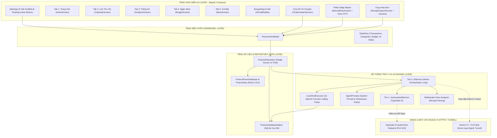

---

## 4. THIẾT KẾ CƠ SỞ DỮ LIỆU SQLITE / ROOM DB & SƠ ĐỒ ERD

Hệ thống quản lý dữ liệu hoàn toàn cục bộ, bảo đảm tính toàn vẹn thông qua các khóa ngoại (Foreign Keys `ON DELETE CASCADE`) và giao dịch nguyên tử (Transactions).

### 4.1 Sơ Đồ Thực Thể Quan Hệ (ERD Diagram)

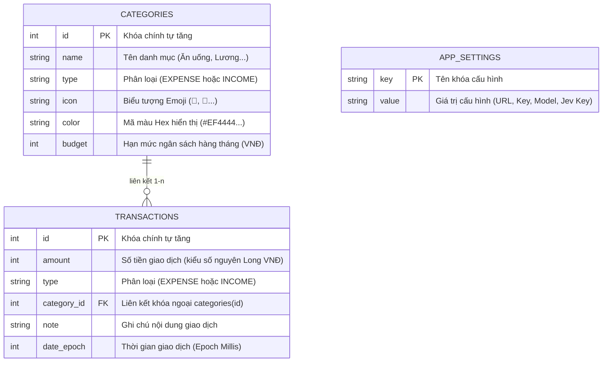

### 4.2 Chi Tiết Cấu Trúc Các Bảng
1. **Bảng `categories`:** Lưu trữ toàn bộ nhóm thu chi. Trường `budget` lưu hạn mức tháng (VNĐ).
2. **Bảng `transactions`:** Lưu trữ từng giao dịch phát sinh. Khóa ngoại `category_id` trỏ đến `categories(id)`.
3. **Bảng `app_settings` (hoặc `settings` trong Room):** Lưu các cấu hình hệ thống:
   * `total_monthly_budget`: Ngân sách tổng chi tiêu trong tháng (VNĐ).
   * `ai_server_url`: Địa chỉ Endpoint AI Server (mặc định: `https://chas-unshaped-jacalyn.ngrok-free.dev`).
   * `ai_model_name`: Tên mô hình AI (`ag/gemini-3.7-flash-high` hoặc `ag/gemini-3.8-flash-high`).
   * `ai_api_key`: Khóa xác thực Bearer API Key.
   * `jev_api_key` & `jev_endpoint`: Khóa và địa chỉ máy chủ JEV Input Guardrail.

---

## 5. SƠ ĐỒ LUỒNG HOẠT ĐỘNG TỔNG THỂ CỦA TOÀN BỘ ỨNG DỤNG

Sơ đồ dưới đây mô tả bức tranh toàn cảnh hành trình người dùng trải qua các kênh nhập liệu, xử lý nghiệp vụ và đồng bộ dữ liệu:

```mermaid
flowchart TD
    Start([Khởi động Ứng Dụng]) --> LoadData[Tải dữ liệu từ SQLite / Room DB]
    LoadData --> Dashboard[Màn hình Chính - Dashboard & 5 Tabs]

    Dashboard --> Choice{Người dùng chọn thao tác nào?}

    %% Nhánh 1: Nhập thủ công & Giọng nói
    Choice -->|Bấm Nút [+] hoặc Micro| InputChannel[Kênh Nhập Nhanh]
    InputChannel -->|Gõ số / NLP / Nói| ExtractNLP[Thuật toán Smart NLP / STT bóc tách số tiền & danh mục]
    ExtractNLP --> SaveManual[Lưu trực tiếp vào SQLite]

    %% Nhánh 2: Quét Hóa Đơn Vision
    Choice -->|Bấm [Chụp Hóa Đơn]| ReceiptCapture[ReceiptCaptureScreen: Chụp ảnh hoặc chọn ảnh]
    ReceiptCapture --> CompressImg[Thu nhỏ ảnh & Nén Base64 JPEG]
    CompressImg --> VisionGemini[Gọi Gemini Multimodal Vision API]
    VisionGemini --> ParseReceiptTable[Trích xuất JSON: Cửa hàng, Danh sách món, Số tiền]
    ParseReceiptTable --> ReviewReceipt[Người dùng xem lại bảng món hàng, chỉnh sửa/xóa]
    ReviewReceipt -->|Bấm Lưu| BatchSaveReceipt[Lưu hàng loạt vào SQLite / Room DB]

    %% Nhánh 3: Trợ Lý AI
    Choice -->|Mở Bong Bóng AI| ChatAI[Cửa sổ ChatAssistantScreen]
    ChatAI --> UserPrompt[Người dùng nhập tin nhắn / nói câu thoại]
    UserPrompt --> JevCheck{Tier 1: JEV Input Guardrail}
    JevCheck -->|Off-Topic: Code, Thơ, Toán...| CannedReply[Trả về ngay câu từ chối lịch sự, 0% token LLM]
    JevCheck -->|Thuộc Tài Chính / Chào hỏi| ReActLoop[Tier 2: Gemini ReAct Loop với 16 Tools]
    ReActLoop --> LocalExec[LocalToolExecutor truy vấn SQLite ngầm]
    LocalExec --> PreviewCards[Hiển thị Thẻ Xem Trước Preview Card trên UI]
    PreviewCards --> UserReview{Người dùng duyệt?}
    UserReview -->|Bấm ✏️ Sửa| EditCard[Sửa trực tiếp tiền/danh mục/ghi chú trên thẻ]
    UserReview -->|Bấm Hủy| CancelCard[Hủy bỏ độc lập khoản đó]
    UserReview -->|Bấm 'Xác Nhận Lưu'| SaveConfirm[Ghi an toàn vào SQLite / Room DB]

    %% Cập nhật chung
    SaveManual --> NotifyUpdate[Cập nhật StateFlow & Bắn Broadcast đồng bộ App Widget]
    BatchSaveReceipt --> NotifyUpdate
    SaveConfirm --> NotifyUpdate
    NotifyUpdate --> Dashboard
```

---

## 5.1 HỆ THỐNG 6 SƠ ĐỒ USE CASE NGHIỆP VỤ (UML USE CASE DIAGRAMS)

### 5.1.1 Sơ Đồ Use Case 1: Tổng Quát Toàn Bộ Hệ Thống (System Overview Use Case)

#### A. Bảng Đặc Tả Tác Nhân Hệ Thống (Actors Matrix)
| Tác Nhân (Actor) | Loại Tác Nhân | Vai Trò & Quyền Hạn Trong Hệ Thống |
| :--- | :--- | :--- |
| **Người Dùng (User)** | Primary Actor | Tác nhân chính trực tiếp vận hành ứng dụng: thêm thu chi, tra cứu lịch, xem biểu đồ phân tích, thiết lập ngân sách và duyệt các hành động do AI đề xuất. |
| **Trợ Lý AI (AI Assistant)** | Supporting Actor | Tác nhân thông minh phân tích câu nói tự nhiên, bóc tách hóa đơn OCR, tổng hợp số liệu tài chính và sinh thẻ đề xuất giao dịch an toàn (Preview Cards). |
| **Hệ Điều Hành Android** | System Platform | Cung cấp các dịch vụ hệ thống cấp thấp: Nhận dạng giọng nói (`SpeechRecognizer`), Khóa vân tay (`BiometricPrompt`), Quản lý tệp (`SAF`), Đồng bộ App Widget (`AppWidgetManager`). |

#### B. Mã Nguồn UML (PlantUML) Use Case Tổng Quát
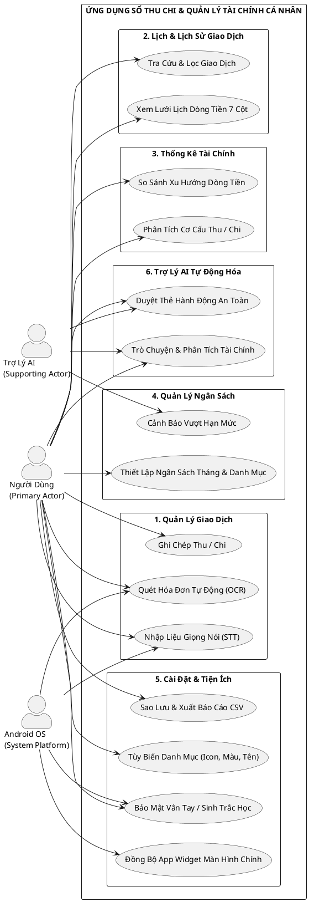

---

### 5.1.2 Sơ Đồ Use Case 2: Phân Hệ Quản Lý Giao Dịch (Transaction Management)

#### A. Bảng Đặc Tả Chi Tiết Các Use Case Giao Dịch
| Mã UC | Tên Use Case | Tác Nhân | Điều Kiện Tiên Quyết | Luồng Nghiệp Vụ Chính |
| :---: | :--- | :--- | :--- | :--- |
| **UC01** | Thêm Khoản Chi Tiêu | Người dùng | Người dùng mở form nhập | Chọn loại Chi tiêu $\rightarrow$ Nhập số tiền $\rightarrow$ Chọn danh mục $\rightarrow$ Ghi chú $\rightarrow$ Lưu SQLite. |
| **UC02** | Thêm Khoản Thu Nhập | Người dùng | Người dùng mở form nhập | Chọn loại Thu nhập $\rightarrow$ Nhập số tiền $\rightarrow$ Chọn nguồn thu $\rightarrow$ Lưu SQLite. |
| **UC03** | Bàn Phím Số & Phím Tắt | Người dùng | Đang nhập tiền | Chạm các nút cộng dồn nhanh (`+10k`, `+50k`, `+100k`, `+500k`, `+1M`) để cập nhật số tiền tức thì. |
| **UC06** | Nhập Bằng Giọng Nói | Người dùng, OS | Cấp quyền Microphone | Nhấn nút Mic $\rightarrow$ Nói tiếng Việt $\rightarrow$ Nhận diện văn bản $\rightarrow$ NLP tự động bóc tách số tiền & danh mục. |
| **UC07** | Quét Hóa Đơn Tự Động | Người dùng, OS | Cấp quyền Camera | Chụp hoặc chọn ảnh hóa đơn $\rightarrow$ Gemini Multimodal bóc tách danh sách mặt hàng $\rightarrow$ Lưu hàng loạt. |
| **UC08** | Chỉnh Sửa Giao Dịch | Người dùng | Có giao dịch sẵn | Mở BottomSheet chỉnh sửa $\rightarrow$ Cập nhật tiền/ghi chú/danh mục $\rightarrow$ Lưu DB & tính lại số dư. |
| **UC09** | Xóa Giao Dịch | Người dùng | Có giao dịch sẵn | Chọn xóa $\rightarrow$ Xác nhận hộp thoại $\rightarrow$ Xóa khỏi DB $\rightarrow$ Hoàn trả số dư ròng & hạn mức ngân sách. |
| **UC10** | Duyệt Thẻ Đề Xuất AI | Người dùng, AI | AI sinh Preview Card | Người dùng kiểm tra thông tin $\rightarrow$ Nhấn nút tick xanh [Xác nhận lưu] $\rightarrow$ Thẻ chuyển CONFIRMED $\rightarrow$ Lưu DB. |

#### B. Mã Nguồn UML (PlantUML) Phân Hệ Giao Dịch
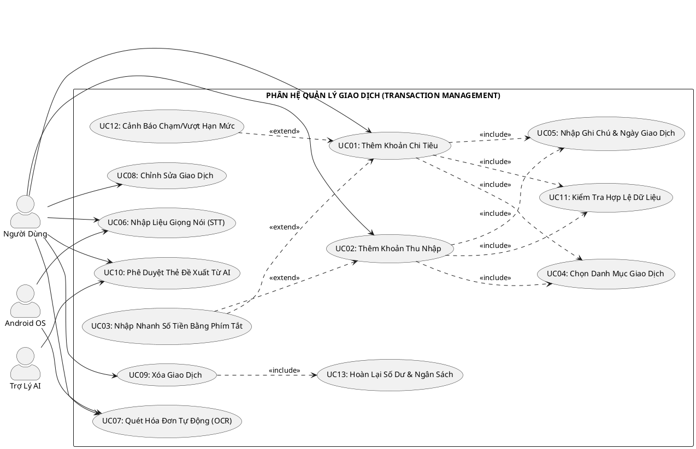

* **Quan hệ `<<include>>`:**
  * Thêm chi tiêu (UC01) và Thu nhập (UC02) bắt buộc bao hàm: Kiểm tra tính hợp lệ dữ liệu (UC11, số tiền > 0), Chọn danh mục (UC04) và Gán ngày ghi nhận (UC05).
  * Xóa giao dịch (UC09) bắt buộc bao hàm Hoàn lại số dư ròng và ngân sách (UC13).
* **Quan hệ `<<extend>>`:**
  * Bàn phím số mở rộng (UC03) mở rộng cho quá trình nhập số tiền.
  * Cảnh báo vượt hạn mức (UC12) mở rộng cho UC01 khi phát hiện tổng chi tiêu chạm hoặc vượt ngân sách tháng.

---

### 5.1.3 Sơ Đồ Use Case 3: Phân Hệ Lịch & Lịch Sử Giao Dịch (Calendar & History)

#### A. Bảng Đặc Tả Use Case Lịch & Lịch Sử
| Mã UC | Tên Use Case | Tác Nhân | Mô Tả Luồng Nghiệp Vụ |
| :---: | :--- | :--- | :--- |
| **UC14** | Xem Lưới Lịch 7 Cột | Người dùng | Render ma trận 7 cột theo tháng, hiển thị chấm tròn tổng thu (xanh lục) và tổng chi (đỏ) dưới từng ngày. |
| **UC15** | Xem Dòng Tiền Tháng | Người dùng | Thanh tóm tắt đầu trang hiển thị: Tổng thu tháng, Tổng chi tháng và Số dư ròng tích lũy. |
| **UC16** | Xem Giao Dịch Ngày | Người dùng | Chạm vào một ngày cụ thể trên lịch để hiển thị danh sách tất cả các khoản thu chi phát sinh trong ngày đó. |
| **UC17** | Chuyển Đổi Tháng | Người dùng | Nhấn nút mũi tên sang trái/phải hoặc chọn năm để tra cứu lịch sử các tháng trước hoặc tháng sau. |
| **UC18** | Tìm Kiếm Từ Khóa | Người dùng | Nhập từ khóa ghi chú (ví dụ: *"xăng"*, *"buffet"*, *"tiền phòng"*) để lọc các giao dịch khớp nội dung. |
| **UC19** | Lọc Thu / Chi | Người dùng | Chuyển bộ lọc hiển thị: Tất cả giao dịch, Chỉ hiển thị Chi tiêu, hoặc Chỉ hiển thị Thu nhập. |
| **UC20** | Xem Chi Tiết Giao Dịch | Người dùng | Chạm vào một dòng giao dịch để mở BottomSheet hiển thị thời gian, số tiền, danh mục, icon và ghi chú. |
| **UC21** | Chỉnh Sửa Từ Lịch | Người dùng | Mở form chỉnh sửa trực tiếp từ BottomSheet của lịch. |
| **UC22** | Xóa Từ Lịch | Người dùng | Xóa giao dịch từ BottomSheet, hệ thống tự động tính lại số tiền thu chi trên ô lịch ngày (UC23). |

#### B. Mã Nguồn UML (PlantUML) Phân Hệ Lịch & Lịch Sử
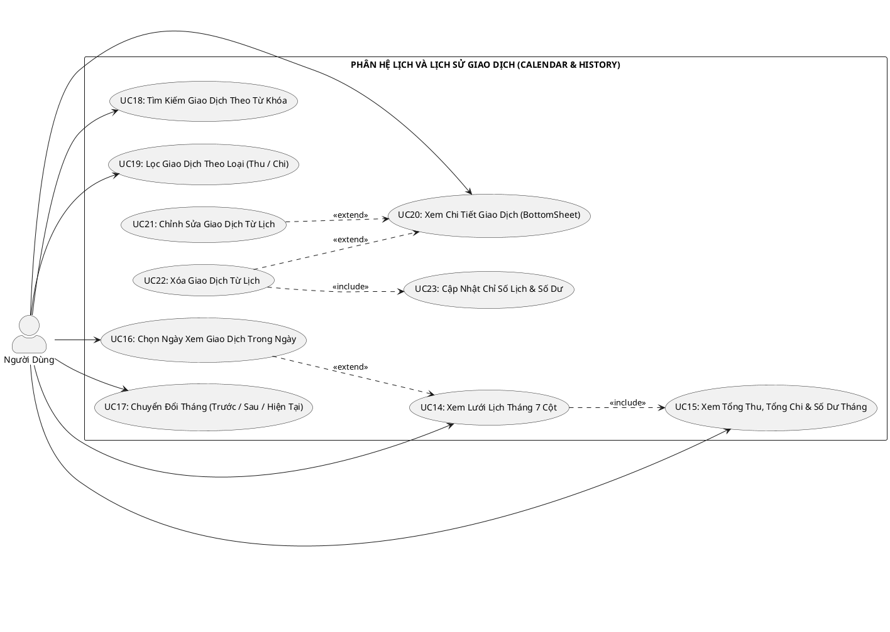

* **Quan hệ `<<include>>`:** Xem lưới lịch (UC14) luôn bao hàm hiển thị tổng kết dòng tiền tháng (UC15); Thao tác xóa giao dịch (UC22) bắt buộc kích hoạt cập nhật lại các chỉ số tổng hợp trên ô ngày tương ứng (UC23).
* **Quan hệ `<<extend>>`:** Chạm vào ô ngày mở rộng hiển thị danh sách ngày (UC16); Xem BottomSheet (UC20) mở rộng cho phép thực hiện chỉnh sửa (UC21) hoặc xóa (UC22).

---

### 5.1.4 Sơ Đồ Use Case 4: Phân Hệ Thống Kê Tài Chính (Financial Analytics)

#### A. Bảng Đặc Tả Use Case Thống Kê
| Mã UC | Tên Use Case | Tác Nhân | Mô Tả Luồng Nghiệp Vụ |
| :---: | :--- | :--- | :--- |
| **UC24** | Xem Dòng Tiền Tổng Quan | Người dùng | Thẻ tổng quan hiển thị 3 chỉ số lớn: Tổng thu tháng, Tổng chi tháng và Số dư ròng kèm màu sắc trực quan. |
| **UC25** | Chuyển Đổi Chi / Thu | Người dùng | Nút gạt chuyển đổi (Segmented Control) cho phép xem phân tích riêng về cơ cấu **Chi tiêu** hoặc cơ cấu **Thu nhập**. |
| **UC26** | Biểu Đồ Tròn (Donut Chart) | Người dùng | Vẽ biểu đồ tròn thể hiện tỷ trọng phần trăm của từng nhóm danh mục với màu sắc tương ứng. |
| **UC27** | Danh Sách Cơ Cấu % | Người dùng | Bảng phân tích chi tiết: Icon, Tên danh mục, Số tiền đã tiêu/thu và tỷ lệ phần trăm đóng góp. |
| **UC28** | Biểu Đồ Xu Hướng | Người dùng | Biểu đồ thanh đối chiếu trực quan cán cân tiền vào và tiền ra trong kỳ. |
| **UC29** | Xếp Hạng Top Chi Tiêu | Người dùng | Liệt kê các khoản chi tiêu có giá trị lớn nhất trong tháng để nhận diện khoản chi đột biến. |
| **UC30** | Chọn Mốc Thời Gian | Người dùng | Lựa chọn tháng hoặc năm cần thống kê để đối chiếu dữ liệu lịch sử. |
| **UC31** | Xem Giao Dịch Thành Phần | Người dùng | Nhấn vào một lát cắt trên biểu đồ Donut để xem danh sách các giao dịch cụ thể cấu thành nên danh mục đó. |

#### B. Mã Nguồn UML (PlantUML) Phân Hệ Thống Kê
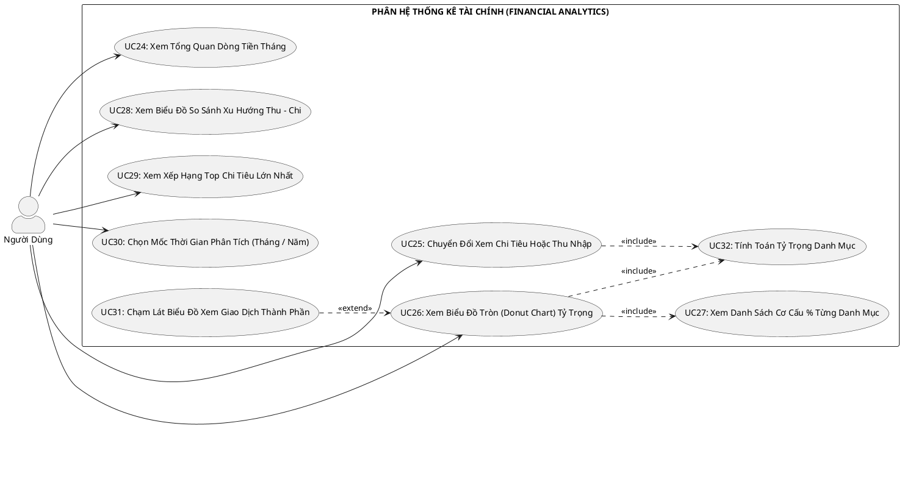

* **Quan hệ `<<include>>`:** Hiển thị biểu đồ Donut (UC26) và chuyển đổi chế độ xem (UC25) bắt buộc bao hàm tính toán lại tỷ trọng phần trăm từ SQLite (UC32) và kết xuất danh sách chi tiết (UC27).
* **Quan hệ `<<extend>>`:** Chạm vào biểu đồ (UC26) mở rộng hành động xem danh sách giao dịch thành phần (UC31).

---

### 5.1.5 Sơ Đồ Use Case 5: Phân Hệ Quản Lý Ngân Sách (Budget Management)

#### A. Bảng Đặc Tả Use Case Ngân Sách
| Mã UC | Tên Use Case | Tác Nhân | Mô Tả Luồng Nghiệp Vụ |
| :---: | :--- | :--- | :--- |
| **UC33** | Xem Ngân Sách Tổng Thể | Người dùng | Hiển thị: Tổng hạn mức chi tiêu tháng, Tổng số tiền đã chi, Số tiền còn lại và phần trăm hoàn thành. |
| **UC34** | Đặt Ngân Sách Tổng | Người dùng | Nhập số tiền hạn mức chi tiêu chung của tháng và lưu vào bảng `tb_settings`. |
| **UC35** | Xem Tiến Độ Ngân Sách Danh Mục | Người dùng | Danh sách tất cả các danh mục kèm thanh tiến độ riêng, số tiền đã tiêu, hạn mức và trạng thái. |
| **UC36** | Đặt Hạn Mức Từng Danh Mục | Người dùng | Thiết lập hạn mức chi tiêu tối đa cho từng nhóm (Ăn uống, Đi lại, Mua sắm...). |
| **UC37** | Theo Dõi Thanh Tiến Độ | Người dùng | Thanh Progress Bar trực quan tự động đổi màu theo tỷ lệ: Xanh lục ($<80\%$), Cam ($80\% - 100\%$), Đỏ ($>100\%$). |
| **UC38** | Cảnh Báo Chạm Ngưỡng (80%) | Hệ thống | Hiển thị thông báo màu Cam cảnh báo người dùng đã chi tiêu gần hết hạn mức cho phép. |
| **UC39** | Cảnh Báo Vượt Hạn Mức (>100%) | Hệ thống | Đổi màu toàn bộ thẻ sang Đỏ Báo Động kèm nhãn **ĐÃ VƯỢT HẠN MỨC** và số tiền vượt cụ thể. |
| **UC40** | Đề Xuất Điều Chỉnh Từ AI | Người dùng, AI | Khi danh mục bị vượt ngân sách, Trợ lý AI tự động sinh thẻ đề xuất nâng hạn mức phù hợp. |

#### B. Mã Nguồn UML (PlantUML) Phân Hệ Ngân Sách
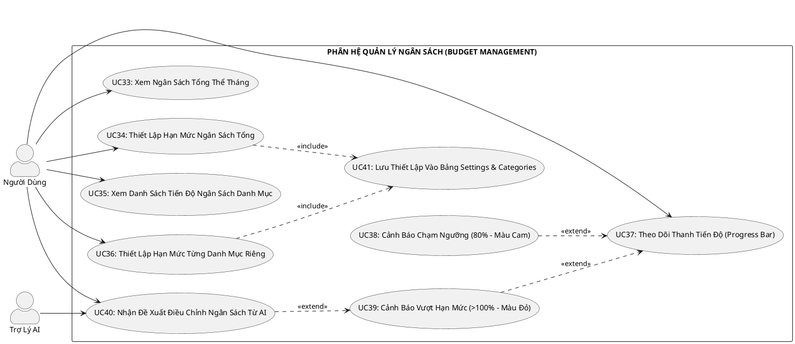

* **Quan hệ `<<include>>`:** Thiết lập ngân sách tổng (UC34) và ngân sách danh mục (UC36) bắt buộc bao hàm ghi nhận cấu hình vào cơ sở dữ liệu (UC41).
* **Quan hệ `<<extend>>`:** Theo dõi tiến độ (UC37) mở rộng kích hoạt trạng thái Cảnh báo màu Cam (UC38) hoặc Báo động Đỏ vượt hạn mức (UC39); Khi bị vượt hạn mức, mở rộng cho AI tự động sinh đề xuất nâng ngân sách (UC40).

---

### 5.1.6 Sơ Đồ Use Case 6: Phân Hệ Cài Đặt & Tiện Ích (Settings & Utilities)

#### A. Bảng Đặc Tả Use Case Cài Đặt & Tiện Ích
| Mã UC | Tên Use Case | Tác Nhân | Mô Tả Luồng Nghiệp Vụ |
| :---: | :--- | :--- | :--- |
| **UC42** | Quản Lý Danh Mục | Người dùng | Xem danh sách danh mục thu/chi, thêm danh mục mới, chỉnh sửa hoặc xóa danh mục không dùng. |
| **UC43** | Tùy Biến Thuộc Tính | Người dùng | Chọn biểu tượng Emoji trực quan, chọn mã màu sắc hiển thị (HEX Color Picker), gán hạn mức mặc định. |
| **UC44** | Khóa Sinh Trắc Học | Người dùng, OS | Bật/tắt bảo vệ mở ứng dụng bằng cảm biến vân tay qua `BiometricPrompt` của Android. |
| **UC45** | Chuyển Đổi Giao Diện | Người dùng | Lựa chọn chế độ hiển thị: Giao diện Sáng (Light Theme), Giao diện Tối (Dark Theme) hoặc Theo hệ thống. |
| **UC46** | Xem App Widget Màn Hình Chính | Người dùng, OS | Widget ngoài màn hình chính Android hiển thị: Số dư ròng tháng, Tổng thu, Tổng chi và phím tắt `[+ Ghi Chép]`. |
| **UC47** | Tự Động Đồng Bộ Widget | Hệ thống OS | Bất kỳ khi nào có giao dịch mới (thêm, sửa, xóa), hệ thống phát Broadcast cập nhật Widget tức thì. |
| **UC48** | Xuất Báo Cáo CSV | Người dùng, OS | Kết xuất toàn bộ lịch sử giao dịch ra định dạng file `.csv` chuẩn UTF-8 qua Android SAF. |
| **UC49** | Sao Lưu & Phục Hồi DB | Người dùng | Sao lưu tệp SQLite cục bộ vào bộ nhớ an toàn và phục hồi lại dữ liệu khi đổi thiết bị. |
| **UC50** | Giới Thiệu Ứng Dụng | Người dùng | Xem phiên bản phát hành, triết lý thiết kế bảo mật Offline-First và hướng dẫn sử dụng ứng dụng **Sổ Thu Chi**. |

#### B. Mã Nguồn UML (PlantUML) Phân Hệ Cài Đặt & Tiện Ích
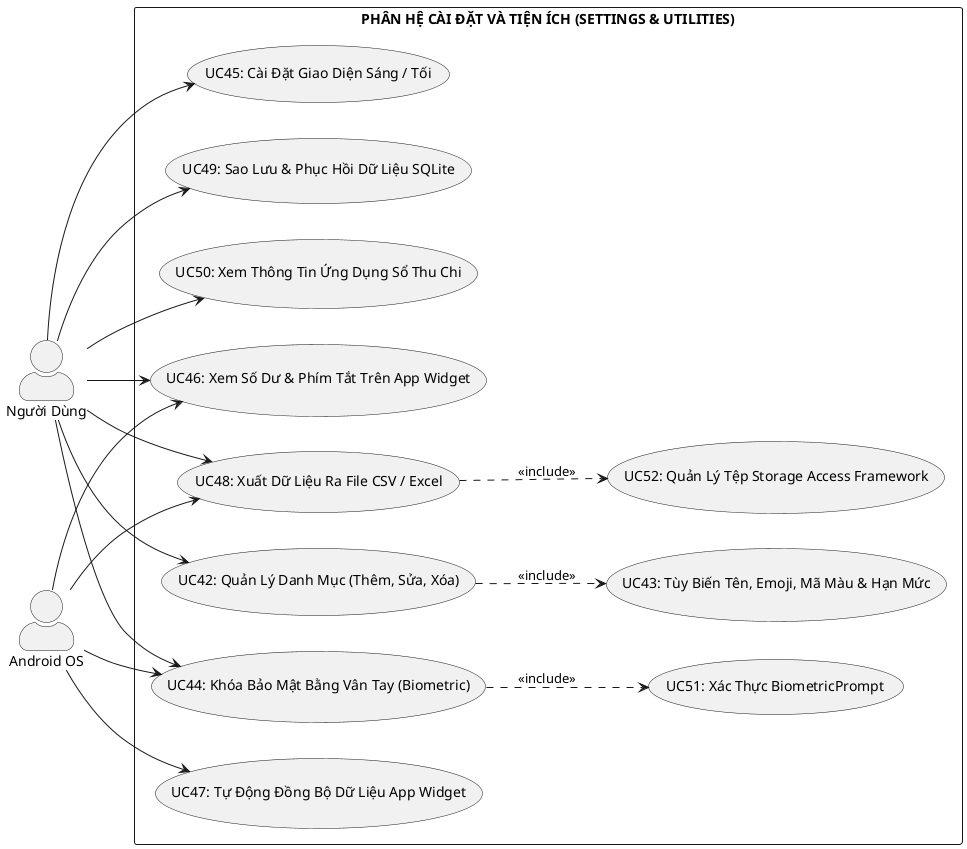

* **Quan hệ `<<include>>`:**
  * Quản lý danh mục (UC42) bao hàm tùy biến thuộc tính định danh (UC43: Emoji, màu HEX, tên, hạn mức).
  * Kích hoạt bảo mật vân tay (UC44) bao hàm gọi API sinh trắc học hệ thống Android (UC51).
  * Xuất file CSV (UC48) bao hàm tương tác với bộ khung quản lý lưu trữ Android Storage Access Framework (UC52).
* **Cơ chế nền tảng:** Mỗi khi có thay đổi trong SQLite qua bất kỳ phân hệ nào, hệ thống tự động bắn broadcast cập nhật trạng thái mới nhất lên App Widget ngoài màn hình chính (UC47).

---

## 5.2 ĐẶC TẢ USE CASE CHI TIẾT

### 5.2.1 Quy Ước Đặc Tả

Phần này đặc tả các mục tiêu nghiệp vụ chính mà người dùng trực tiếp thực hiện. Các use case kỹ thuật dạng `<<include>>` hoặc `<<extend>>` như kiểm tra hợp lệ, tính tỷ trọng, cập nhật chỉ số và gọi dịch vụ Android được mô tả trong luồng cha tương ứng để tránh lặp lại nội dung.

| Thuộc tính | Ý nghĩa |
| :--- | :--- |
| **Mã và tên** | Mã định danh đồng nhất với sơ đồ tại mục 5.1 và file `docs/usecase_diagrams.puml`. |
| **Tác nhân chính** | Người hoặc hệ thống khởi tạo use case. |
| **Tác nhân phụ** | Thành phần hỗ trợ như Trợ lý AI hoặc Android OS. |
| **Kích hoạt** | Sự kiện bắt đầu use case. |
| **Tiền điều kiện** | Điều kiện phải đúng trước khi thực hiện. |
| **Hậu điều kiện** | Trạng thái hệ thống sau khi thành công hoặc thất bại. |
| **Luồng chính** | Chuỗi hành động thành công thông thường. |
| **Luồng thay thế/ngoại lệ** | Nhánh tùy chọn, dữ liệu không hợp lệ hoặc lỗi hệ thống. |
| **Quy tắc nghiệp vụ** | Các ràng buộc dữ liệu và an toàn bắt buộc. |

### 5.2.2 UC01 – Thêm Khoản Chi Tiêu

| Thuộc tính | Nội dung |
| :--- | :--- |
| **Mục tiêu** | Ghi nhận một khoản tiền đã chi vào sổ tài chính. |
| **Tác nhân chính** | Người dùng. |
| **Kích hoạt** | Người dùng nhấn nút `[+]`, mở form nhập nhanh và chọn **Chi tiêu**. |
| **Tiền điều kiện** | Ứng dụng đã khởi tạo; tồn tại ít nhất một danh mục loại `EXPENSE`. |
| **Hậu điều kiện thành công** | Một giao dịch `EXPENSE` được lưu; số dư, thống kê, ngân sách và widget được cập nhật. |
| **Hậu điều kiện thất bại** | Không tạo bản ghi; dữ liệu cũ giữ nguyên; giao diện hiển thị nguyên nhân. |
| **Use case liên quan** | `<<include>>` UC04, UC05, UC11; `<<extend>>` UC03, UC12. |

**Luồng chính:**

1. Hệ thống hiển thị form nhập giao dịch và mặc định ngày hiện tại.
2. Người dùng nhập số tiền lớn hơn 0 hoặc sử dụng các phím cộng nhanh UC03.
3. Người dùng chọn một danh mục chi tiêu theo UC04.
4. Người dùng chọn ngày, nhập ghi chú tùy chọn theo UC05.
5. Người dùng nhấn **Lưu giao dịch**.
6. Hệ thống kiểm tra dữ liệu theo UC11.
7. Hệ thống ghi giao dịch vào SQLite/Room trong một thao tác nguyên tử.
8. Hệ thống tính lại tổng thu, tổng chi, số dư và mức sử dụng ngân sách.
9. Nếu đạt ngưỡng cảnh báo, hệ thống kích hoạt UC12.
10. Hệ thống thông báo lưu thành công, làm mới StateFlow và App Widget.

**Luồng thay thế và ngoại lệ:**

- **A1 – Nhập câu tự nhiên:** Người dùng nhập như `ăn trưa 45k`; bộ Smart NLP điền trước số tiền, danh mục và ghi chú để người dùng kiểm tra.
- **A2 – Chọn ngày quá khứ:** Giao dịch được ghi cho ngày đã chọn và các thống kê của kỳ tương ứng được tính lại.
- **E1 – Số tiền trống, bằng 0 hoặc không hợp lệ:** Hệ thống không lưu và đánh dấu ô số tiền.
- **E2 – Chưa chọn danh mục:** Hệ thống yêu cầu chọn danh mục chi tiêu.
- **E3 – Lỗi database:** Giao dịch được rollback và hiển thị thông báo thử lại.

**Quy tắc nghiệp vụ:** `amount` dùng số nguyên `Long` theo đơn vị VNĐ; loại giao dịch phải là `EXPENSE`; danh mục phải tồn tại và cùng loại; không cho phép số âm; cảnh báo ngân sách không ngăn người dùng lưu giao dịch hợp lệ.

### 5.2.3 UC02 – Thêm Khoản Thu Nhập

| Thuộc tính | Nội dung |
| :--- | :--- |
| **Mục tiêu** | Ghi nhận một khoản tiền thu vào sổ tài chính. |
| **Tác nhân chính** | Người dùng. |
| **Kích hoạt** | Người dùng mở form nhập nhanh và chọn **Thu nhập**. |
| **Tiền điều kiện** | Tồn tại ít nhất một danh mục loại `INCOME`. |
| **Hậu điều kiện thành công** | Giao dịch `INCOME` được lưu và số dư tăng tương ứng. |
| **Use case liên quan** | `<<include>>` UC04, UC05, UC11; `<<extend>>` UC03. |

**Luồng chính:**

1. Người dùng chọn loại **Thu nhập**.
2. Người dùng nhập số tiền, chọn nguồn thu, ngày và ghi chú.
3. Hệ thống xác thực số tiền và tính tương thích của danh mục.
4. Người dùng nhấn **Lưu giao dịch**.
5. Hệ thống lưu bản ghi `INCOME`, cập nhật số dư và thông báo thành công.
6. Hệ thống đồng bộ danh sách gần đây, lịch, thống kê và App Widget.

**Luồng thay thế và ngoại lệ:**

- **A1 – Nhập nhanh:** Câu `lương tháng này 15tr` được NLP nhận diện là `15.000.000 đ` và danh mục Lương.
- **E1 – Danh mục thuộc loại chi:** Hệ thống không lưu và yêu cầu chọn danh mục thu nhập.
- **E2 – Dữ liệu không hợp lệ hoặc lỗi DB:** Không thay đổi dữ liệu và hiển thị lỗi.

**Quy tắc nghiệp vụ:** Thu nhập không làm tăng phần trăm đã sử dụng của ngân sách chi tiêu; số dư ròng được tính bằng `Tổng thu - Tổng chi`.

### 5.2.4 UC06 – Nhập Liệu Bằng Giọng Nói

| Thuộc tính | Nội dung |
| :--- | :--- |
| **Mục tiêu** | Chuyển câu nói tiếng Việt thành dữ liệu giao dịch để giảm thao tác nhập tay. |
| **Tác nhân chính** | Người dùng. |
| **Tác nhân phụ** | Android OS (`RecognizerIntent`/dịch vụ nhận dạng giọng nói). |
| **Kích hoạt** | Người dùng nhấn biểu tượng Microphone trên form nhập. |
| **Tiền điều kiện** | Thiết bị hỗ trợ nhận dạng giọng nói; quyền microphone đã được cấp khi nền tảng yêu cầu. |
| **Hậu điều kiện thành công** | Form được điền trước từ văn bản nhận dạng; chưa lưu DB cho tới khi người dùng bấm Lưu. |
| **Use case liên quan** | Mở rộng UC01 hoặc UC02; dùng UC04 và UC11 trước khi lưu. |

**Luồng chính:**

1. Người dùng nhấn nút Microphone.
2. Ứng dụng yêu cầu Android OS bắt đầu nhận dạng tiếng Việt.
3. Người dùng đọc nội dung, ví dụ `đổ xăng 70k`.
4. Android OS trả văn bản đã nhận dạng.
5. Bộ phân tích cục bộ trích xuất loại giao dịch, số tiền, danh mục và ghi chú.
6. Hệ thống điền dữ liệu lên form để người dùng kiểm tra hoặc chỉnh sửa.
7. Người dùng xác nhận lưu theo UC01 hoặc UC02.

**Luồng thay thế và ngoại lệ:**

- **A1 – Chỉ nhận dạng được ghi chú:** Hệ thống giữ nội dung văn bản và yêu cầu người dùng nhập số tiền/chọn danh mục.
- **E1 – Từ chối quyền hoặc thiết bị không hỗ trợ:** Hiển thị hướng dẫn và cho phép nhập tay.
- **E2 – Không nghe rõ/timeout:** Không thay đổi dữ liệu form hiện có; cho phép thử lại.

**Quy tắc nghiệp vụ:** Kết quả Speech-to-Text là dữ liệu gợi ý, không được tự động ghi DB; người dùng luôn được xem và sửa trước khi lưu.

### 5.2.5 UC07 – Quét Hóa Đơn Tự Động

| Thuộc tính | Nội dung |
| :--- | :--- |
| **Mục tiêu** | Trích xuất các dòng thanh toán từ ảnh hóa đơn thành danh sách giao dịch nháp. |
| **Tác nhân chính** | Người dùng. |
| **Tác nhân phụ** | Android OS, mô hình AI multimodal. |
| **Kích hoạt** | Người dùng chọn **Chụp hóa đơn** hoặc chọn ảnh từ thư viện. |
| **Tiền điều kiện** | Có ảnh hợp lệ; đã cấu hình máy chủ AI; có kết nối mạng; có danh mục chi tiêu. |
| **Hậu điều kiện thành công** | Các dòng hợp lệ được hiển thị dạng bản nháp; chỉ những dòng được xác nhận mới được lưu. |
| **Hậu điều kiện thất bại** | Không ghi giao dịch; ảnh và dữ liệu cá nhân không được đưa vào sổ. |

**Luồng chính:**

1. Người dùng mở màn hình quét hóa đơn.
2. Người dùng chụp ảnh hoặc chọn ảnh có sẵn.
3. Ứng dụng nén/chuyển ảnh sang Base64 và gửi tới endpoint multimodal.
4. AI trả JSON gồm cửa hàng, ngày và các mặt hàng với số lượng, thành tiền, danh mục.
5. Hệ thống kiểm tra JSON, bỏ các dòng có số tiền không hợp lệ và đối chiếu danh mục cục bộ.
6. Hệ thống hiển thị danh sách dòng nháp để người dùng sửa, bỏ chọn hoặc đổi danh mục.
7. Người dùng chọn **Lưu tất cả** hoặc xác nhận từng dòng.
8. Hệ thống lưu các dòng đã duyệt trong giao dịch DB và cập nhật toàn bộ chỉ số.

**Luồng thay thế và ngoại lệ:**

- **A1 – Chỉ đọc được tổng tiền:** Tạo một dòng `Tổng hóa đơn` thay vì tự suy đoán mặt hàng.
- **A2 – Danh mục AI không tồn tại:** Dùng bộ ghép danh mục cục bộ; nếu vẫn không khớp thì dùng `Khác`.
- **E1 – Ảnh trống/không đọc được:** Không tạo bản nháp và yêu cầu ảnh rõ hơn.
- **E2 – JSON sai schema hoặc không có dòng hợp lệ:** Không lưu, hiển thị lỗi phân tích.
- **E3 – Lỗi mạng/xác thực:** Giữ màn hình hiện tại và cho phép thử lại.

**Quy tắc nghiệp vụ:** `amount` là thành tiền của cả dòng, nguyên VNĐ; không tạo thêm dòng tổng nếu hóa đơn đã có chi tiết; không suy đoán chữ hoặc số bị mờ; mọi dòng đều cần người dùng duyệt trước khi lưu.

### 5.2.6 UC08 – Chỉnh Sửa Giao Dịch

| Thuộc tính | Nội dung |
| :--- | :--- |
| **Mục tiêu** | Sửa số tiền, danh mục, ngày hoặc ghi chú của giao dịch đã tồn tại. |
| **Tác nhân chính** | Người dùng. |
| **Kích hoạt** | Người dùng chọn một giao dịch và nhấn **Sửa**. |
| **Tiền điều kiện** | Giao dịch còn tồn tại trong DB. |
| **Hậu điều kiện thành công** | Giao dịch được cập nhật; các tổng hợp liên quan được tính lại. |
| **Hậu điều kiện thất bại** | Giao dịch giữ nguyên trạng thái trước khi chỉnh sửa. |

**Luồng chính:**

1. Hệ thống tải thông tin hiện tại vào form.
2. Người dùng chỉnh một hoặc nhiều trường.
3. Người dùng nhấn **Xác nhận sửa**.
4. Hệ thống kiểm tra dữ liệu và sự tồn tại của giao dịch.
5. Hệ thống cập nhật bản ghi trong một thao tác nguyên tử.
6. Hệ thống tính lại số liệu của cả kỳ cũ và kỳ mới nếu ngày/loại giao dịch thay đổi.
7. Giao diện, StateFlow và Widget được đồng bộ.

**Luồng thay thế và ngoại lệ:**

- **A1 – Người dùng hủy:** Đóng form, không thay đổi DB.
- **E1 – Giao dịch đã bị xóa ở luồng khác:** Thông báo không còn dữ liệu và tải lại danh sách.
- **E2 – Giá trị mới không hợp lệ:** Giữ form để người dùng sửa lại.

**Quy tắc nghiệp vụ:** Không được đổi sang danh mục khác loại với giao dịch; mọi số liệu tổng hợp phải được tính từ DB sau cập nhật, không cộng/trừ thủ công trên UI.

### 5.2.7 UC09 – Xóa Giao Dịch

| Thuộc tính | Nội dung |
| :--- | :--- |
| **Mục tiêu** | Loại bỏ một giao dịch nhập sai khỏi sổ. |
| **Tác nhân chính** | Người dùng. |
| **Kích hoạt** | Người dùng chọn **Xóa** tại chi tiết giao dịch. |
| **Tiền điều kiện** | Giao dịch tồn tại. |
| **Hậu điều kiện thành công** | Giao dịch bị xóa; UC13 cập nhật lại số dư và mức sử dụng ngân sách. |
| **Use case liên quan** | `<<include>>` UC13. |

**Luồng chính:**

1. Hệ thống hiển thị hộp thoại xác nhận cùng thông tin giao dịch.
2. Người dùng nhấn **Xác nhận xóa**.
3. Hệ thống xóa giao dịch khỏi DB.
4. Hệ thống tính lại số dư, lịch, thống kê, ngân sách và Widget.
5. Hệ thống thông báo xóa thành công.

**Luồng thay thế và ngoại lệ:**

- **A1 – Hủy xóa:** Đóng hộp thoại, dữ liệu không thay đổi.
- **E1 – Bản ghi không tồn tại/lỗi DB:** Không thay đổi các bản ghi khác và hiển thị lỗi.

**Quy tắc nghiệp vụ:** Xóa là thao tác phá hủy nên luôn cần xác nhận rõ ràng; nếu do AI đề xuất thì còn phải đi qua Preview Card của UC10.

### 5.2.8 UC10 – Duyệt Thẻ Hành Động Do AI Đề Xuất

| Thuộc tính | Nội dung |
| :--- | :--- |
| **Mục tiêu** | Cho phép người dùng kiểm soát mọi thao tác ghi dữ liệu do Trợ lý AI đề xuất. |
| **Tác nhân chính** | Người dùng. |
| **Tác nhân phụ** | Trợ lý AI. |
| **Kích hoạt** | Agent trả về một hoặc nhiều `ToolAction` ở trạng thái `PENDING`. |
| **Tiền điều kiện** | Preview Card chứa action và dữ liệu tối thiểu hợp lệ. |
| **Hậu điều kiện xác nhận** | Action được thực thi, thẻ chuyển `CONFIRMED`, dữ liệu và thống kê được đồng bộ. |
| **Hậu điều kiện hủy** | Thẻ chuyển `CANCELLED`; DB không thay đổi. |

**Luồng chính:**

1. Người dùng gửi yêu cầu tài chính bằng ngôn ngữ tự nhiên.
2. Guardrail kiểm tra phạm vi; ReAct orchestrator có thể gọi query tool để lấy dữ liệu thật.
3. Agent gọi action tool nhưng hệ thống chỉ tạo `ToolAction(PENDING)`, chưa ghi DB.
4. UI hiển thị Preview Card với loại hành động, số tiền, danh mục và ghi chú.
5. Người dùng kiểm tra và nhấn **Xác nhận**.
6. Hệ thống xác thực lại action theo dữ liệu hiện tại.
7. Repository thực thi action và cập nhật trạng thái thẻ thành `CONFIRMED`.
8. Trạng thái xác nhận được đưa vào lịch sử để agent trả lời đúng ở lượt sau.

**Luồng thay thế và ngoại lệ:**

- **A1 – Chỉnh sửa:** Người dùng sửa số tiền/danh mục/ghi chú trên thẻ rồi mới xác nhận.
- **A2 – Hủy:** Đánh dấu riêng action là `CANCELLED`, không ghi DB.
- **A3 – Nhiều action:** Người dùng xác nhận/hủy từng thẻ hoặc dùng nút xác nhận tất cả; trạng thái từng thẻ độc lập.
- **E1 – Dữ liệu đích đã thay đổi:** Không thực thi update/delete và yêu cầu tải lại.
- **E2 – Action không hợp lệ:** Giữ ở trạng thái chờ hoặc báo lỗi; không ghi một phần ngoài chủ ý.

**Quy tắc nghiệp vụ:** LLM không có quyền ghi trực tiếp; query tool chỉ đọc; mọi action tạo/sửa/xóa/danh mục/ngân sách phải qua xác nhận; lịch sử phải phân biệt rõ `PENDING`, `CONFIRMED`, `CANCELLED`.

### 5.2.9 UC14–UC20 – Xem, Điều Hướng và Tra Cứu Lịch Giao Dịch

| Thuộc tính | Nội dung |
| :--- | :--- |
| **Mục tiêu** | Xem dòng tiền theo tháng/ngày và tìm giao dịch cần quan tâm. |
| **Tác nhân chính** | Người dùng. |
| **Kích hoạt** | Người dùng mở tab Lịch. |
| **Tiền điều kiện** | Database đã khởi tạo; có thể chưa có giao dịch. |
| **Hậu điều kiện** | Không thay đổi dữ liệu; trạng thái tháng, ngày, bộ lọc và kết quả hiển thị được cập nhật. |
| **Use case liên quan** | UC14 `<<include>>` UC15; UC16 và UC20 mở rộng UC14; UC18, UC19 áp dụng bộ lọc. |

**Luồng chính:**

1. Hệ thống tải tháng hiện tại và tổng hợp dữ liệu từng ngày.
2. Hệ thống hiển thị lưới lịch 7 cột cùng tổng thu/chi của từng ô ngày.
3. Hệ thống hiển thị tổng thu, tổng chi và số dư tháng theo UC15.
4. Người dùng chuyển tháng theo UC17 hoặc chọn một ngày theo UC16.
5. Hệ thống tải danh sách giao dịch tương ứng.
6. Người dùng nhập từ khóa UC18 hoặc chọn loại Thu/Chi UC19.
7. Hệ thống lọc và hiển thị kết quả.
8. Người dùng chọn một dòng để mở chi tiết UC20, từ đó có thể gọi UC21/UC22.

**Luồng thay thế và ngoại lệ:**

- **A1 – Không có dữ liệu:** Hiển thị trạng thái rỗng và tổng bằng 0, không coi là lỗi.
- **A2 – Xóa bộ lọc:** Khôi phục toàn bộ giao dịch của ngày/tháng đang chọn.
- **E1 – Lỗi đọc DB:** Hiển thị thông báo và tùy chọn tải lại.

**Quy tắc nghiệp vụ:** Các phép tổng hợp lấy trực tiếp từ dữ liệu đã lưu; tháng dùng đúng múi giờ thiết bị; sau UC21/UC22 phải chạy UC23 để cập nhật chỉ số.

### 5.2.10 UC24–UC31 – Phân Tích và Thống Kê Tài Chính

| Thuộc tính | Nội dung |
| :--- | :--- |
| **Mục tiêu** | Giúp người dùng hiểu cơ cấu và xu hướng dòng tiền theo kỳ. |
| **Tác nhân chính** | Người dùng. |
| **Kích hoạt** | Người dùng mở tab Thống kê. |
| **Tiền điều kiện** | Database sẵn sàng; kỳ phân tích hợp lệ. |
| **Hậu điều kiện** | Không thay đổi DB; biểu đồ và danh sách phản ánh kỳ/loại đang chọn. |
| **Use case liên quan** | UC26 và UC25 `<<include>>` UC32; UC26 `<<include>>` UC27; UC31 `<<extend>>` UC26. |

**Luồng chính:**

1. Hệ thống chọn tháng hiện tại và tải tổng quan UC24.
2. Người dùng chọn phân tích Chi tiêu hoặc Thu nhập theo UC25.
3. Hệ thống nhóm giao dịch theo danh mục và tính tỷ trọng UC32.
4. Hệ thống vẽ Donut Chart UC26 và danh sách cơ cấu UC27.
5. Hệ thống hiển thị so sánh Thu–Chi UC28 và Top chi tiêu UC29.
6. Người dùng đổi kỳ theo UC30; hệ thống tính lại toàn bộ dữ liệu.
7. Người dùng chạm lát biểu đồ để xem giao dịch thành phần UC31.

**Luồng thay thế và ngoại lệ:**

- **A1 – Tổng bằng 0:** Không thực hiện phép chia; hiển thị biểu đồ rỗng và tỷ lệ 0%.
- **A2 – Chỉ có một danh mục:** Hiển thị danh mục đó với tỷ lệ 100%.
- **E1 – Dữ liệu không nhất quán:** Bỏ bản ghi không hợp lệ khỏi biểu đồ, ghi nhận lỗi nội bộ và không làm ứng dụng dừng.

**Quy tắc nghiệp vụ:** Tổng tỷ trọng sau làm tròn phải xấp xỉ 100%; số tiền âm không được tham gia; màu danh mục lấy từ cấu hình danh mục; thay đổi kỳ hoặc loại phải tính lại từ nguồn dữ liệu duy nhất.

### 5.2.11 UC33–UC41 – Xem và Thiết Lập Ngân Sách

| Thuộc tính | Nội dung |
| :--- | :--- |
| **Mục tiêu** | Theo dõi và thay đổi hạn mức chi tiêu tổng thể hoặc theo danh mục. |
| **Tác nhân chính** | Người dùng. |
| **Tác nhân phụ** | Trợ lý AI đối với UC40. |
| **Kích hoạt** | Người dùng mở tab Ngân sách hoặc chọn sửa hạn mức. |
| **Tiền điều kiện** | Kỳ ngân sách hợp lệ; danh mục tồn tại nếu đặt hạn mức danh mục. |
| **Hậu điều kiện thành công** | Hạn mức được lưu bởi UC41; tiến độ và cảnh báo được tính lại. |
| **Use case liên quan** | UC34/UC36 `<<include>>` UC41; UC38/UC39 `<<extend>>` UC37; UC40 mở rộng UC39. |

**Luồng chính:**

1. Hệ thống đọc hạn mức và tổng chi tháng, hiển thị tổng quan UC33.
2. Hệ thống hiển thị tiến độ từng danh mục UC35 và Progress Bar UC37.
3. Người dùng chọn sửa ngân sách tổng UC34 hoặc ngân sách danh mục UC36.
4. Người dùng nhập hạn mức mới lớn hơn hoặc bằng 0.
5. Hệ thống hiển thị giá trị cũ/mới và yêu cầu xác nhận.
6. Hệ thống lưu cấu hình qua UC41.
7. Hệ thống tính lại phần trăm và số tiền còn lại/vượt.
8. Hệ thống hiển thị màu cam UC38 khi đạt từ 80% đến 100%, màu đỏ UC39 khi vượt 100%.

**Luồng thay thế và ngoại lệ:**

- **A1 – Đặt 0:** Hiểu là chưa thiết lập/tắt hạn mức theo quy ước của hệ thống; không chia cho 0.
- **A2 – Đề xuất từ AI:** AI tạo Preview Card UC40; chỉ lưu sau khi người dùng duyệt theo UC10.
- **E1 – Giá trị âm hoặc sai định dạng:** Không lưu và yêu cầu nhập lại.
- **E2 – Danh mục không còn tồn tại:** Đóng dialog, làm mới danh sách.

**Quy tắc nghiệp vụ:** `remaining = max(budget - spent, 0)` khi hiển thị; số vượt bằng `spent - budget`; vượt ngân sách phải dùng cụm từ **vượt hạn mức**, không diễn đạt thành “còn thiếu”; thay đổi hạn mức không sửa các giao dịch lịch sử.

### 5.2.12 UC42–UC43 – Quản Lý và Tùy Biến Danh Mục

| Thuộc tính | Nội dung |
| :--- | :--- |
| **Mục tiêu** | Thêm, sửa hoặc xóa danh mục thu/chi và thuộc tính hiển thị. |
| **Tác nhân chính** | Người dùng. |
| **Kích hoạt** | Người dùng mở màn hình Quản lý danh mục. |
| **Tiền điều kiện** | Database đã khởi tạo. |
| **Hậu điều kiện thành công** | Danh mục và các màn hình sử dụng danh mục được đồng bộ. |
| **Use case liên quan** | UC42 `<<include>>` UC43. |

**Luồng chính:**

1. Hệ thống hiển thị danh mục Thu và Chi.
2. Người dùng chọn thêm mới hoặc chọn một danh mục hiện có.
3. Người dùng nhập tên, loại, Emoji, màu HEX và hạn mức tùy chọn.
4. Hệ thống kiểm tra tính hợp lệ và trùng tên trong cùng loại.
5. Người dùng xác nhận.
6. Hệ thống lưu và cập nhật các form, biểu đồ, ngân sách liên quan.

**Luồng thay thế và ngoại lệ:**

- **A1 – Sửa danh mục:** Hệ thống giữ nguyên ID để các giao dịch cũ tiếp tục liên kết.
- **A2 – Xóa danh mục:** Hiển thị cảnh báo ảnh hưởng và yêu cầu chọn phương án xử lý giao dịch liên quan nếu cần.
- **E1 – Trùng tên/thiếu tên/màu sai:** Không lưu, hiển thị trường lỗi.
- **E2 – Vi phạm khóa ngoại:** Không xóa và hướng dẫn chuyển giao dịch sang danh mục khác.

**Quy tắc nghiệp vụ:** Tên không được rỗng; loại chỉ là `EXPENSE` hoặc `INCOME`; không tạo danh mục trùng trong cùng loại; thao tác từ AI phải qua UC10.

### 5.2.13 UC44/UC51 – Khóa Bảo Mật Bằng Sinh Trắc Học

| Thuộc tính | Nội dung |
| :--- | :--- |
| **Mục tiêu** | Bảo vệ truy cập ứng dụng bằng cơ chế xác thực của Android. |
| **Tác nhân chính** | Người dùng. |
| **Tác nhân phụ** | Android OS (`BiometricPrompt`). |
| **Kích hoạt** | Người dùng bật khóa sinh trắc học hoặc mở ứng dụng khi khóa đang bật. |
| **Tiền điều kiện** | Thiết bị hỗ trợ, có sinh trắc học đã đăng ký và cơ chế khóa thiết bị phù hợp. |
| **Hậu điều kiện thành công** | Cài đặt được bật hoặc người dùng được phép truy cập ứng dụng. |
| **Use case liên quan** | UC44 `<<include>>` UC51. |

**Luồng chính:**

1. Người dùng bật tùy chọn khóa sinh trắc học.
2. Ứng dụng kiểm tra khả năng hỗ trợ của thiết bị.
3. Android OS hiển thị `BiometricPrompt`.
4. Người dùng xác thực thành công.
5. Hệ thống lưu trạng thái bật khóa.
6. Ở lần mở sau, ứng dụng yêu cầu xác thực trước khi hiển thị dữ liệu tài chính.

**Luồng thay thế và ngoại lệ:**

- **A1 – Dùng thông tin xác thực thiết bị:** Android OS cho phép PIN/mật khẩu nếu cấu hình hỗ trợ.
- **E1 – Không hỗ trợ/chưa đăng ký:** Không bật khóa; hướng dẫn người dùng cấu hình thiết bị.
- **E2 – Thất bại hoặc hủy:** Không cho vào vùng dữ liệu được bảo vệ; cho phép thử lại theo giới hạn nền tảng.

**Quy tắc nghiệp vụ:** Ứng dụng không lưu mẫu vân tay; toàn bộ xác thực do Android OS thực hiện; không log dữ liệu sinh trắc học.

### 5.2.14 UC46–UC47 – Xem và Đồng Bộ App Widget

| Thuộc tính | Nội dung |
| :--- | :--- |
| **Mục tiêu** | Hiển thị nhanh số dư, tổng thu/chi và lối tắt ghi chép ở màn hình chính. |
| **Tác nhân chính** | Người dùng. |
| **Tác nhân phụ** | Android OS/AppWidgetManager. |
| **Kích hoạt** | Người dùng thêm Widget hoặc dữ liệu giao dịch thay đổi. |
| **Tiền điều kiện** | Widget đã được thêm; ứng dụng/DB khả dụng. |
| **Hậu điều kiện** | RemoteViews của các widget đang hoạt động hiển thị số liệu mới nhất. |

**Luồng chính:**

1. Android OS yêu cầu Widget cập nhật.
2. Provider đọc tổng thu, tổng chi và số dư tháng hiện tại.
3. Provider định dạng số tiền và cập nhật RemoteViews.
4. Người dùng nhấn `[+ Ghi Chép]` để mở màn hình nhập giao dịch.
5. Sau thao tác thêm/sửa/xóa, ứng dụng kích hoạt UC47 để cập nhật lại Widget.

**Luồng thay thế và ngoại lệ:**

- **A1 – Chưa có dữ liệu:** Hiển thị các giá trị 0 đ.
- **E1 – Không đọc được DB:** Giữ dữ liệu gần nhất hoặc hiển thị trạng thái mặc định; không làm launcher lỗi.

**Quy tắc nghiệp vụ:** Widget chỉ hiển thị dữ liệu tổng hợp cần thiết; PendingIntent phải trỏ đúng màn hình; mọi widget instance đang hoạt động phải được cập nhật.

### 5.2.15 UC48/UC52 – Xuất Báo Cáo CSV

| Thuộc tính | Nội dung |
| :--- | :--- |
| **Mục tiêu** | Xuất lịch sử giao dịch thành tệp để người dùng lưu trữ hoặc phân tích. |
| **Tác nhân chính** | Người dùng. |
| **Tác nhân phụ** | Android OS (Storage Access Framework). |
| **Kích hoạt** | Người dùng chọn **Xuất báo cáo CSV**. |
| **Tiền điều kiện** | Có quyền đọc dữ liệu ứng dụng; trình chọn tệp của Android khả dụng. |
| **Hậu điều kiện thành công** | Tệp UTF-8 được tạo tại URI do người dùng chọn; DB không thay đổi. |
| **Use case liên quan** | UC48 `<<include>>` UC52. |

**Luồng chính:**

1. Người dùng chọn phạm vi thời gian và bộ lọc xuất.
2. Ứng dụng đọc các giao dịch phù hợp.
3. Android OS hiển thị trình chọn vị trí/tên tệp.
4. Ứng dụng ghi tiêu đề và từng dòng CSV theo UTF-8.
5. Hệ thống đóng stream và thông báo vị trí tệp thành công.

**Luồng thay thế và ngoại lệ:**

- **A1 – Không có giao dịch:** Cho phép xuất tệp chỉ có tiêu đề hoặc yêu cầu người dùng đổi phạm vi.
- **E1 – Người dùng hủy SAF:** Kết thúc use case, không tạo tệp.
- **E2 – Không thể ghi/thiếu dung lượng:** Đóng stream, thông báo lỗi và không thay đổi DB.

**Quy tắc nghiệp vụ:** Escape đúng dấu phẩy, dấu nháy và xuống dòng; định dạng ngày giờ nhất quán; không xuất API key hoặc cấu hình bí mật.

### 5.2.16 UC49 – Sao Lưu và Phục Hồi Dữ Liệu

| Thuộc tính | Nội dung |
| :--- | :--- |
| **Mục tiêu** | Cho phép người dùng sao lưu hoặc khôi phục dữ liệu tài chính khi đổi thiết bị. |
| **Tác nhân chính** | Người dùng. |
| **Tác nhân phụ** | Android OS/Storage Access Framework. |
| **Kích hoạt** | Người dùng chọn **Sao lưu** hoặc **Phục hồi**. |
| **Tiền điều kiện** | Có quyền truy cập URI do người dùng chọn; không có transaction ghi đang mở. |
| **Hậu điều kiện sao lưu** | Một bản sao nhất quán được tạo; DB hiện tại không đổi. |
| **Hậu điều kiện phục hồi** | DB được thay thế bằng bản hợp lệ và ứng dụng tải lại toàn bộ state. |

**Luồng chính – Sao lưu:**

1. Người dùng chọn Sao lưu và vị trí lưu.
2. Hệ thống hoàn tất các transaction đang chờ và tạo snapshot nhất quán.
3. Hệ thống ghi bản sao vào URI được chọn.
4. Hệ thống thông báo hoàn tất.

**Luồng chính – Phục hồi:**

1. Người dùng chọn tệp sao lưu.
2. Hệ thống kiểm tra định dạng, phiên bản schema và tính toàn vẹn.
3. Hệ thống cảnh báo dữ liệu hiện tại sẽ bị thay thế và yêu cầu xác nhận lần nữa.
4. Hệ thống tạo bản dự phòng tạm thời, đóng kết nối DB và phục hồi atomically.
5. Hệ thống mở lại DB, nạp state và cập nhật Widget.

**Luồng thay thế và ngoại lệ:**

- **A1 – Hủy trước xác nhận:** Không thay đổi dữ liệu.
- **E1 – Tệp hỏng/khác phiên bản:** Từ chối phục hồi và giữ nguyên DB hiện tại.
- **E2 – Phục hồi thất bại:** Khôi phục bản dự phòng tạm thời và báo lỗi.

**Quy tắc nghiệp vụ:** Phục hồi là thao tác có rủi ro cao nên cần xác nhận kép; không ghi đè DB trước khi kiểm tra tệp; tệp sao lưu không được chứa API key dạng rõ nếu không có cơ chế bảo vệ phù hợp.

### 5.2.17 Ma Trận Truy Vết Đặc Tả – Sơ Đồ

| Nhóm đặc tả chi tiết | Các mã UC được bao phủ |
| :--- | :--- |
| Thêm giao dịch Thu/Chi | UC01–UC05, UC11–UC12 |
| Giọng nói và OCR | UC06–UC07 |
| Sửa/xóa/duyệt hành động | UC08–UC10, UC13 |
| Lịch và lịch sử | UC14–UC23 |
| Thống kê | UC24–UC32 |
| Ngân sách | UC33–UC41 |
| Danh mục | UC42–UC43 |
| Sinh trắc học | UC44, UC51 |
| Giao diện | UC45; được mô tả tại mục 6 và phần thiết kế giao diện |
| Widget | UC46–UC47 |
| Xuất và sao lưu | UC48–UC49, UC52 |
| Thông tin ứng dụng | UC50; là use case chỉ đọc, mô tả tại màn hình Cài đặt |

Ma trận trên bảo đảm toàn bộ UC01–UC52 trong sáu sơ đồ đều có vị trí đặc tả hoặc tham chiếu rõ ràng trong báo cáo.

---

## 5.3 ĐẶC TẢ ĐẦY ĐỦ TỪNG USE CASE CỦA NGƯỜI DÙNG

Mục này tách riêng từng use case mà **Người dùng** trực tiếp khởi tạo hoặc tương tác trên giao diện. Mỗi UC được đặc tả độc lập thay vì gộp theo luồng như mục 5.2. Các UC thuần xử lý nội bộ của Hệ thống/Android OS được liệt kê riêng tại mục 5.3.6.

### 5.3.1 Phân Hệ Quản Lý Giao Dịch

| Mã UC | Tên Use Case | Tác nhân | Kích hoạt & Tiền điều kiện | Luồng chính | Hậu điều kiện | Luồng thay thế / Ngoại lệ |
| :---: | :--- | :--- | :--- | :--- | :--- | :--- |
| **UC01** | Thêm khoản chi tiêu | Người dùng | Mở form nhập; có danh mục `EXPENSE`. | Chọn Chi tiêu → nhập số tiền → chọn danh mục → chọn ngày/ghi chú → nhấn Lưu → hệ thống kiểm tra và ghi DB. | Tạo một giao dịch chi; cập nhật số dư, lịch, thống kê, ngân sách và Widget. | Thiếu tiền/danh mục: không lưu; lỗi DB: rollback; chạm/vượt hạn mức: vẫn lưu nhưng cảnh báo. |
| **UC02** | Thêm khoản thu nhập | Người dùng | Mở form nhập; có danh mục `INCOME`. | Chọn Thu nhập → nhập tiền → chọn nguồn thu → nhập ngày/ghi chú → lưu. | Tạo giao dịch thu và tăng số dư ròng tương ứng. | Danh mục sai loại hoặc tiền không hợp lệ: từ chối lưu; lỗi DB: giữ nguyên dữ liệu. |
| **UC03** | Nhập nhanh số tiền bằng phím tắt | Người dùng | Đang ở trường nhập tiền của UC01/UC02. | Nhấn `+10k`, `+20k`, `+50k`, `+100k`, `+500k`, `+1tr` hoặc Xóa → hệ thống cộng/đặt lại giá trị và định dạng VNĐ. | Giá trị trên form thay đổi; DB chưa thay đổi. | Tràn giới hạn `Long`: không cộng và báo lỗi; nhấn Xóa: đưa giá trị về 0. |
| **UC04** | Chọn danh mục giao dịch | Người dùng | Đã chọn loại Thu hoặc Chi; danh mục đã được tải. | Hệ thống lọc danh mục đúng loại → người dùng chọn một mục → UI đánh dấu lựa chọn. | Form giữ `categoryId` hợp lệ cùng loại giao dịch. | Không có danh mục: đề nghị tạo mới; đổi loại giao dịch: xóa lựa chọn không tương thích. |
| **UC05** | Nhập ghi chú và ngày giao dịch | Người dùng | Đang tạo hoặc sửa giao dịch. | Chọn ngày bằng Date Picker → nhập ghi chú tùy chọn → quay lại form. | Form giữ ngày epoch và nội dung ghi chú để lưu. | Không chọn ngày: dùng ngày hiện tại; ghi chú trống: vẫn hợp lệ; ngày sai phạm vi: yêu cầu chọn lại. |
| **UC06** | Nhập liệu bằng giọng nói | Người dùng; Android OS | Nhấn Microphone; dịch vụ nhận dạng khả dụng và quyền đã được cấp. | OS thu giọng nói → trả văn bản → NLP tách tiền, loại, danh mục, ghi chú → điền trước form → người dùng kiểm tra. | Form có dữ liệu gợi ý; chưa ghi DB trước khi người dùng lưu. | Từ chối quyền/timeout/không nghe rõ: giữ form và cho nhập tay hoặc thử lại. |
| **UC07** | Quét hóa đơn tự động | Người dùng; Android OS; AI | Chọn Camera/Thư viện; có ảnh, mạng và cấu hình AI hợp lệ. | Chọn ảnh → gửi mô hình multimodal → kiểm tra JSON → ghép danh mục → hiển thị các dòng nháp → người dùng duyệt và lưu. | Các dòng được duyệt trở thành giao dịch chi; dữ liệu tổng hợp được cập nhật. | Chỉ đọc được tổng: tạo một dòng Tổng hóa đơn; ảnh/JSON/lỗi mạng: không ghi DB và cho thử lại. |
| **UC08** | Chỉnh sửa giao dịch | Người dùng | Chọn Sửa trên một giao dịch còn tồn tại. | Tải dữ liệu cũ → người dùng sửa tiền/danh mục/ngày/ghi chú → xác nhận → kiểm tra → cập nhật DB. | Bản ghi và các tổng hợp của kỳ liên quan được cập nhật. | Hủy: giữ dữ liệu cũ; bản ghi đã mất/dữ liệu mới sai: không cập nhật và báo lỗi. |
| **UC09** | Xóa giao dịch | Người dùng | Chọn Xóa trên giao dịch tồn tại. | Hiển thị thông tin và cảnh báo → người dùng xác nhận → xóa DB → tính lại số dư/ngân sách. | Bản ghi không còn; lịch, thống kê và Widget được đồng bộ. | Hủy: không đổi DB; lỗi hoặc bản ghi không tồn tại: báo lỗi, không ảnh hưởng bản ghi khác. |
| **UC10** | Phê duyệt thẻ đề xuất từ AI | Người dùng; Trợ lý AI | Agent đã tạo `ToolAction` trạng thái `PENDING`. | Xem Preview Card → kiểm tra/sửa → nhấn Xác nhận → hệ thống xác thực lại → thực thi action → đổi trạng thái thẻ. | Action được lưu và thẻ thành `CONFIRMED`; nếu hủy thì thành `CANCELLED` và DB không đổi. | Nhiều thẻ: duyệt từng thẻ hoặc tất cả; dữ liệu đích thay đổi/action sai: từ chối thực thi an toàn. |

### 5.3.2 Phân Hệ Lịch và Lịch Sử Giao Dịch

| Mã UC | Tên Use Case | Tác nhân | Kích hoạt & Tiền điều kiện | Luồng chính | Hậu điều kiện | Luồng thay thế / Ngoại lệ |
| :---: | :--- | :--- | :--- | :--- | :--- | :--- |
| **UC14** | Xem lưới lịch tháng 7 cột | Người dùng | Mở tab Lịch; DB đã khởi tạo. | Tải tháng hiện tại → nhóm giao dịch theo ngày → dựng lưới Thứ 2–Chủ nhật → hiển thị tổng thu/chi trên từng ngày. | Lịch và ngày hiện tại được hiển thị; DB không đổi. | Tháng không có dữ liệu: hiển thị lưới với các tổng bằng 0; lỗi đọc DB: cho tải lại. |
| **UC15** | Xem tổng thu, tổng chi và số dư tháng | Người dùng | Đang xem một tháng trong UC14. | Hệ thống cộng thu và chi của tháng → tính `Số dư = Thu - Chi` → hiển thị ba chỉ số. | Người dùng thấy tổng hợp đúng tháng đang chọn. | Không có dữ liệu: hiển thị 0 đ; lỗi tổng hợp: không dùng số liệu cache sai và báo tải lại. |
| **UC16** | Chọn ngày xem giao dịch trong ngày | Người dùng | Lưới lịch đã hiển thị. | Chạm một ngày → đánh dấu ngày → truy vấn giao dịch trong khoảng đầu/cuối ngày → hiển thị danh sách và tổng ngày. | Ngày được chọn trở thành bộ lọc hiện hành. | Ngày trống: hiển thị trạng thái chưa có giao dịch; chạm lại ngày đang chọn: giữ nguyên hoặc làm mới. |
| **UC17** | Chuyển đổi tháng | Người dùng | Đang ở tab Lịch. | Nhấn tháng trước/tháng sau/hiện tại → cập nhật năm-tháng → tải lại lưới và tổng hợp. | Giao diện phản ánh kỳ mới; ngày chọn được đặt lại phù hợp. | Kỳ không có dữ liệu: hiển thị rỗng; lỗi truy vấn: giữ kỳ đang xem và báo lỗi. |
| **UC18** | Tìm kiếm giao dịch theo từ khóa | Người dùng | Có danh sách giao dịch hoặc kỳ đang chọn. | Nhập từ khóa → chuẩn hóa chuỗi → lọc theo ghi chú/danh mục → hiển thị kết quả. | Danh sách chỉ còn các bản ghi phù hợp; DB không đổi. | Từ khóa trống: hiển thị toàn bộ; không có kết quả: hiện trạng thái rỗng; lỗi: cho thử lại. |
| **UC19** | Lọc giao dịch theo loại Thu/Chi | Người dùng | Danh sách giao dịch đã tải. | Chọn Tất cả, Thu nhập hoặc Chi tiêu → áp dụng điều kiện loại → cập nhật danh sách và tổng nếu cần. | Bộ lọc được giữ trong state màn hình. | Không có bản ghi phù hợp: hiển thị rỗng; bỏ lọc: khôi phục Tất cả. |
| **UC20** | Xem chi tiết giao dịch | Người dùng | Có ít nhất một giao dịch trong danh sách. | Chạm giao dịch → tải dữ liệu theo ID → mở BottomSheet với tiền, loại, danh mục, ngày và ghi chú. | Chi tiết được hiển thị; DB không đổi. | Bản ghi đã bị xóa: đóng sheet và tải lại; lỗi đọc: báo lỗi. |
| **UC21** | Chỉnh sửa giao dịch từ lịch | Người dùng | BottomSheet UC20 đang mở. | Chọn Sửa → mở form đã điền → thực hiện luồng UC08 → quay lại lịch và tính lại ngày/tháng. | Giao dịch và chỉ số lịch được cập nhật. | Hủy sửa: quay về chi tiết; lỗi cập nhật: giữ dữ liệu cũ. |
| **UC22** | Xóa giao dịch từ lịch | Người dùng | BottomSheet UC20 đang mở. | Chọn Xóa → xác nhận → thực hiện UC09 → chạy UC23 cập nhật ô ngày và số dư. | Giao dịch biến mất khỏi lịch; chỉ số ngày/tháng chính xác. | Hủy: đóng dialog; lỗi xóa: giữ dòng và hiển thị lỗi. |

### 5.3.3 Phân Hệ Thống Kê Tài Chính

| Mã UC | Tên Use Case | Tác nhân | Kích hoạt & Tiền điều kiện | Luồng chính | Hậu điều kiện | Luồng thay thế / Ngoại lệ |
| :---: | :--- | :--- | :--- | :--- | :--- | :--- |
| **UC24** | Xem tổng quan dòng tiền tháng | Người dùng | Mở tab Thống kê; chọn được một kỳ. | Đọc giao dịch của kỳ → tính tổng thu, tổng chi, số dư → hiển thị thẻ tổng quan. | Có ảnh chụp tài chính của kỳ; DB không đổi. | Không có dữ liệu: hiển thị 0 đ; lỗi DB: báo tải lại. |
| **UC25** | Chuyển đổi phân tích Chi/Thu | Người dùng | Dữ liệu thống kê đã tải. | Chọn Chi tiêu hoặc Thu nhập → lọc đúng loại → tính lại tỷ trọng → cập nhật biểu đồ và danh sách. | Chế độ phân tích hiện hành được cập nhật. | Loại được chọn không có dữ liệu: hiển thị biểu đồ rỗng và tỷ lệ 0%. |
| **UC26** | Xem biểu đồ Donut tỷ trọng | Người dùng | Có tổng dữ liệu theo loại; UC32 đã tính nhóm danh mục. | Chuẩn hóa tỷ trọng → vẽ lát cắt theo màu danh mục → hiển thị chú giải. | Biểu đồ phản ánh cơ cấu danh mục trong kỳ. | Tổng bằng 0: không chia cho 0, hiển thị trạng thái rỗng; lỗi render: vẫn hiển thị danh sách số liệu. |
| **UC27** | Xem danh sách cơ cấu phần trăm | Người dùng | Dữ liệu nhóm danh mục đã tính. | Sắp xếp theo số tiền → hiển thị icon, tên, tiền và tỷ lệ của từng danh mục. | Người dùng đọc được số liệu chi tiết tương ứng biểu đồ. | Một danh mục: hiển thị 100%; sai số làm tròn: tổng có thể xấp xỉ 100%. |
| **UC28** | Xem biểu đồ so sánh xu hướng Thu–Chi | Người dùng | Có dữ liệu kỳ hoặc các mốc so sánh. | Tổng hợp theo mốc thời gian → dựng hai chuỗi Thu/Chi → vẽ cột/thanh so sánh. | Xu hướng dòng tiền được hiển thị; DB không đổi. | Thiếu một chuỗi: hiển thị chuỗi còn lại và 0 cho chuỗi thiếu. |
| **UC29** | Xem xếp hạng Top chi tiêu | Người dùng | Kỳ đang chọn có thể có giao dịch chi. | Lọc `EXPENSE` → sắp xếp giảm dần theo tiền → lấy các khoản đầu → hiển thị. | Danh sách các khoản chi lớn nhất được tạo. | Không có chi tiêu: hiển thị rỗng; các khoản bằng nhau: dùng ngày/ID để ổn định thứ tự. |
| **UC30** | Chọn mốc thời gian phân tích | Người dùng | Đang ở màn hình Thống kê. | Chọn tháng/năm → kiểm tra kỳ → truy vấn lại → cập nhật UC24–UC29. | Toàn bộ thống kê dùng cùng một kỳ mới. | Kỳ tương lai/chưa có dữ liệu: hiển thị 0; lựa chọn không hợp lệ: giữ kỳ cũ. |
| **UC31** | Xem giao dịch thành phần của biểu đồ | Người dùng | Donut Chart có lát cắt. | Chạm lát cắt → xác định danh mục → lọc giao dịch cùng kỳ/loại/danh mục → hiển thị danh sách. | Người dùng truy vết được số liệu tổng hợp về giao dịch nguồn. | Lát quá nhỏ/không xác định: yêu cầu chọn từ chú giải; dữ liệu vừa đổi: tải lại biểu đồ. |

### 5.3.4 Phân Hệ Quản Lý Ngân Sách

| Mã UC | Tên Use Case | Tác nhân | Kích hoạt & Tiền điều kiện | Luồng chính | Hậu điều kiện | Luồng thay thế / Ngoại lệ |
| :---: | :--- | :--- | :--- | :--- | :--- | :--- |
| **UC33** | Xem ngân sách tổng thể tháng | Người dùng | Mở tab Ngân sách; DB sẵn sàng. | Đọc hạn mức tháng và tổng chi → tính đã dùng, còn lại, phần trăm → hiển thị. | Trạng thái ngân sách tháng được trình bày; DB không đổi. | Chưa đặt ngân sách: hiển thị hướng dẫn thiết lập; hạn mức 0: không chia cho 0. |
| **UC34** | Thiết lập ngân sách tổng | Người dùng | Chọn sửa ngân sách tháng. | Nhập hạn mức → xem giá trị cũ/mới → xác nhận → kiểm tra → UC41 lưu setting → tính lại tiến độ. | Hạn mức tổng mới có hiệu lực cho kỳ. | Nhập âm/sai định dạng: không lưu; hủy: giữ hạn mức cũ; lỗi DB: rollback. |
| **UC35** | Xem tiến độ ngân sách danh mục | Người dùng | Có danh mục chi tiêu. | Đọc hạn mức và tổng chi từng danh mục → tính tỷ lệ/trạng thái → sắp xếp và hiển thị danh sách. | Người dùng thấy danh mục an toàn, gần ngưỡng hoặc vượt ngưỡng. | Danh mục chưa có hạn mức: hiển thị Chưa thiết lập; không có chi: tiến độ 0%. |
| **UC36** | Thiết lập hạn mức từng danh mục | Người dùng | Chọn một danh mục `EXPENSE` còn tồn tại. | Mở dialog → nhập hạn mức → xác nhận → kiểm tra → UC41 lưu vào danh mục → cập nhật tiến độ. | Danh mục có hạn mức mới; cảnh báo được tính lại. | Danh mục bị xóa: đóng dialog; tiền âm/sai: từ chối; hủy: không đổi. |
| **UC37** | Theo dõi thanh tiến độ ngân sách | Người dùng | Có số đã chi và hạn mức. | Tính `spent/budget` → vẽ Progress Bar → gán xanh dưới 80%, cam 80–100%, đỏ trên 100%. | Màu, tỷ lệ và số tiền phản ánh dữ liệu hiện tại. | Hạn mức 0: dùng trạng thái Chưa thiết lập; dữ liệu đổi: StateFlow tự cập nhật. |
| **UC40** | Nhận đề xuất điều chỉnh ngân sách từ AI | Người dùng; Trợ lý AI | Ngân sách đã vượt hoặc người dùng yêu cầu tư vấn; AI khả dụng. | Agent query số liệu thật → đề xuất hạn mức → tạo Preview Card → người dùng sửa/duyệt theo UC10. | Nếu xác nhận, hạn mức mới được lưu; nếu hủy, DB không đổi. | AI/network lỗi: giữ ngân sách cũ; đề xuất sai/không mong muốn: người dùng hủy hoặc sửa. |

### 5.3.5 Phân Hệ Cài Đặt và Tiện Ích

| Mã UC | Tên Use Case | Tác nhân | Kích hoạt & Tiền điều kiện | Luồng chính | Hậu điều kiện | Luồng thay thế / Ngoại lệ |
| :---: | :--- | :--- | :--- | :--- | :--- | :--- |
| **UC42** | Quản lý danh mục | Người dùng | Mở màn hình Danh mục; DB sẵn sàng. | Xem danh sách → chọn thêm/sửa/xóa → nhập hoặc xác nhận dữ liệu → hệ thống kiểm tra và lưu. | Danh mục và các màn hình phụ thuộc được đồng bộ. | Trùng tên/thiếu tên: không lưu; xóa có giao dịch liên quan: yêu cầu chuyển hoặc từ chối an toàn. |
| **UC43** | Tùy biến tên, Emoji, màu và hạn mức | Người dùng | Đang thêm/sửa danh mục UC42. | Nhập tên → chọn Emoji → chọn màu HEX → nhập hạn mức tùy chọn → xem trước → xác nhận. | Thuộc tính danh mục được lưu và dùng thống nhất trên UI/biểu đồ. | Màu/tên/hạn mức sai: đánh dấu trường lỗi; hủy: khôi phục giá trị cũ. |
| **UC44** | Khóa bảo mật bằng sinh trắc học | Người dùng; Android OS | Bật tùy chọn; thiết bị hỗ trợ và đã đăng ký sinh trắc học. | Kiểm tra khả năng → OS mở BiometricPrompt → xác thực → lưu trạng thái bật → yêu cầu xác thực ở lần mở sau. | Chỉ người xác thực thành công mới truy cập dữ liệu khi khóa bật. | Không hỗ trợ/chưa đăng ký: hướng dẫn cấu hình; thất bại/hủy: không bật hoặc không cho truy cập. |
| **UC45** | Cài đặt giao diện Sáng/Tối | Người dùng | Mở Cài đặt giao diện. | Chọn Sáng, Tối hoặc Theo hệ thống → lưu lựa chọn → áp dụng theme Compose. | Giao diện đổi ngay và được khôi phục ở lần mở sau. | Theo hệ thống: cập nhật khi OS đổi theme; lỗi lưu: áp dụng tạm thời và báo lỗi nếu cần. |
| **UC46** | Xem số dư và phím tắt trên App Widget | Người dùng; Android OS | Widget đã được thêm vào màn hình chính. | OS yêu cầu cập nhật → provider đọc tổng tháng → hiển thị số dư/thu/chi → người dùng nhấn phím tắt để mở form. | Widget hiển thị số liệu mới nhất và điều hướng đúng. | Chưa có dữ liệu: hiển thị 0 đ; lỗi DB: giữ dữ liệu gần nhất hoặc trạng thái mặc định. |
| **UC48** | Xuất dữ liệu CSV/Excel | Người dùng; Android OS | Chọn Xuất dữ liệu; SAF khả dụng. | Chọn phạm vi → hệ thống đọc giao dịch → OS cho chọn URI → ghi CSV UTF-8 → đóng stream → báo thành công. | Tạo tệp tại vị trí người dùng chọn; DB không đổi. | Hủy SAF: không tạo; lỗi ghi/thiếu dung lượng: đóng stream và báo lỗi; không có dữ liệu: xuất tiêu đề hoặc cảnh báo. |
| **UC49** | Sao lưu và phục hồi SQLite | Người dùng; Android OS | Chọn Sao lưu/Phục hồi; có URI truy cập được. | Sao lưu: tạo snapshot và ghi tệp. Phục hồi: kiểm tra tệp → cảnh báo → xác nhận kép → thay DB nguyên tử → tải lại state. | Có bản sao hợp lệ hoặc DB được phục hồi thành công. | Tệp hỏng/khác schema: từ chối; hủy: không đổi; phục hồi lỗi: quay lại bản dự phòng. |
| **UC50** | Xem thông tin ứng dụng | Người dùng | Chọn Giới thiệu trong Cài đặt. | Hệ thống tải tên, phiên bản, mô tả Offline-First và hướng dẫn → hiển thị trang thông tin. | Người dùng xem được thông tin; không thay đổi dữ liệu. | Thiếu metadata: hiển thị giá trị mặc định; liên kết ngoài không mở được: báo lỗi nhưng giữ trang. |

### 5.3.6 Các Use Case Hệ Thống Hỗ Trợ, Không Do User Trực Tiếp Khởi Tạo

Các UC dưới đây vẫn thuộc mô hình đầy đủ UC01–UC52 nhưng không phải hành động độc lập của Người dùng. Chúng được hệ thống hoặc Android OS thực thi trong luồng cha:

| Mã UC | Tác nhân thực thi | Vai trò | Được kích hoạt từ |
| :---: | :--- | :--- | :--- |
| **UC11** | Hệ thống | Kiểm tra số tiền, loại, danh mục và dữ liệu bắt buộc. | UC01, UC02, UC08. |
| **UC12** | Hệ thống | Phát cảnh báo khi khoản chi chạm/vượt hạn mức. | UC01, UC37. |
| **UC13** | Hệ thống | Tính lại số dư và ngân sách sau khi xóa. | UC09. |
| **UC23** | Hệ thống | Cập nhật tổng trên ô lịch và phần tổng hợp. | UC21, UC22. |
| **UC32** | Hệ thống | Nhóm dữ liệu và tính tỷ trọng danh mục. | UC25, UC26, UC27. |
| **UC38** | Hệ thống | Hiển thị trạng thái cảnh báo màu cam ở ngưỡng 80–100%. | UC37. |
| **UC39** | Hệ thống | Hiển thị trạng thái vượt hạn mức màu đỏ trên 100%. | UC37, UC40. |
| **UC41** | Hệ thống | Lưu ngân sách vào Settings/Categories. | UC34, UC36, UC40. |
| **UC47** | Android OS/Hệ thống | Nhận broadcast và đồng bộ App Widget. | UC01, UC02, UC08, UC09, UC10. |
| **UC51** | Android OS | Thực hiện `BiometricPrompt`; ứng dụng không đọc mẫu sinh trắc học. | UC44. |
| **UC52** | Android OS | Cấp URI đọc/ghi qua Storage Access Framework. | UC48, UC49. |

Như vậy, **41 use case có tương tác trực tiếp với Người dùng** được đặc tả riêng tại mục 5.3.1–5.3.5; **11 use case hỗ trợ nội bộ** được phân loại tại mục 5.3.6. Tổng cộng khớp đủ **52 use case** trong bộ sơ đồ UML.

---

## 6. CHI TIẾT 5 PHÂN HỆ GIAO DIỆN & TIỆN ÍCH MỞ RỘNG

### 6.1 Tab 0: Trang Chủ (Dashboard Tổng Quan)
* **Thẻ Số Dư & Dòng Tiền (Balance Card):** Hiển thị tổng thu, tổng chi và số dư khả dụng với phong cách thẻ tín dụng cao cấp.
* **Tiến Độ Ngân Sách Nhanh:** Hiển thị phần trăm đã tiêu so với hạn mức tháng kèm thanh trạng thái đổi màu linh hoạt.
* **Giao Dịch Gần Đây (Recent Activity):** Liệt kê các khoản thu chi mới nhất, hỗ trợ chạm để sửa/xóa nhanh.
* **Bong Bóng Nổi Trợ Lý AI (Floating Bubble):** Tự do kéo thả khắp các vị trí trên màn hình; chạm vào để mở ngay cửa sổ trò chuyện thông minh.

### 6.2 Tab 1: Lịch Thu Chi Trực Quan (Calendar View)
* **Lưới lịch tháng 7 cột:** Hiển thị trực quan từng ngày trong tháng kèm tổng thu (xanh lục) và tổng chi (đỏ) dưới mỗi ngày.
* **Bảng tổng hợp linh hoạt (Summary Header):** Dễ dàng chuyển đổi xem chỉ số tài chính theo **Từng ngày đã chọn** hoặc **Toàn bộ tháng**.

### 6.3 Tab 2: Thống Kê & Phân Tích Chuyên Sâu (Analytics)
* **Biểu Đồ Donut Tỷ Trọng:** Phân tích trực quan phần trăm chi tiêu của từng nhóm danh mục.
* **Thanh Dòng Tiền Thu vs Chi:** So sánh tỷ lệ tiền vào và tiền ra để đánh giá sức khỏe tài chính.
* **Top Khoản Chi Tiêu Lớn Nhất:** Liệt kê các khoản chi tiêu có giá trị cao nhất giúp kiểm soát chi tiêu bất thường.

### 6.4 Tab 3: Quản Lý Ngân Sách Đa Tầng (Budgeting)
* **Ngân Sách Tổng Thể:** Thiết lập hạn mức chi tiêu chung của tháng với 3 cấp độ cảnh báo trực quan:
  * Xanh lục ($< 80\%$): An toàn.
  * Cam ($80\% - 100\%$): Cảnh báo chạm hạn mức.
  * Đỏ thẫm ($> 100\%$): **Đã Vượt Ngân Sách** kèm số tiền vượt cụ thể.
* **Ngân Sách Từng Danh Mục:** Đặt hạn mức riêng cho từng nhóm (Ăn uống, Đi lại, Giải trí...) để kiểm soát chi tiêu vi mô.

### 6.5 Tab 4: Cài Đặt, Danh Mục & Cấu Hình Máy Chủ AI
* **Quản Lý Danh Mục:** Thêm mới, đổi tên, biểu tượng Emoji, mã màu sắc và hạn mức ngân sách.
* **Cấu Hình AI Server & API Key:** Cung cấp ô nhập Server URL (Ngrok / Proxy), Model ID, API Key Bearer, JEV Guardrail Key kèm nút **Kiểm Tra Kết Nối (Ping)** hiển thị tích xanh tức thì.

### 6.6 Nút Nổi Trung Tâm (Floating Action Button) & App Widget
* **Action Menu Trung Tâm:** Nhấn nút `[+]` mở bảng tùy chọn chuyển hướng nhanh giữa **Nhập thủ công (Smart NLP)** và **Chụp hóa đơn (Vision OCR)**.
* **App Widget Ngoài Màn Hình Chính (Home Screen Widget):** Hiển thị trực tiếp Số dư ròng, Tổng thu, Tổng chi tháng và phím tắt `[+ Ghi Chép]` mở thẳng ứng dụng, tự động cập nhật mỗi khi có giao dịch mới.

---

## 7. CHUYÊN SÂU KIẾN TRÚC TRỢ LÝ AI: PHÒNG THỦ 2 TẦNG & REACT ENGINE

Hệ thống Trợ lý AI được thiết kế theo tiêu chuẩn công nghiệp với mô hình phòng thủ 2 tầng (**Two-Tier Defense**) và quy trình suy luận **ReAct (Reasoning + Acting)**:

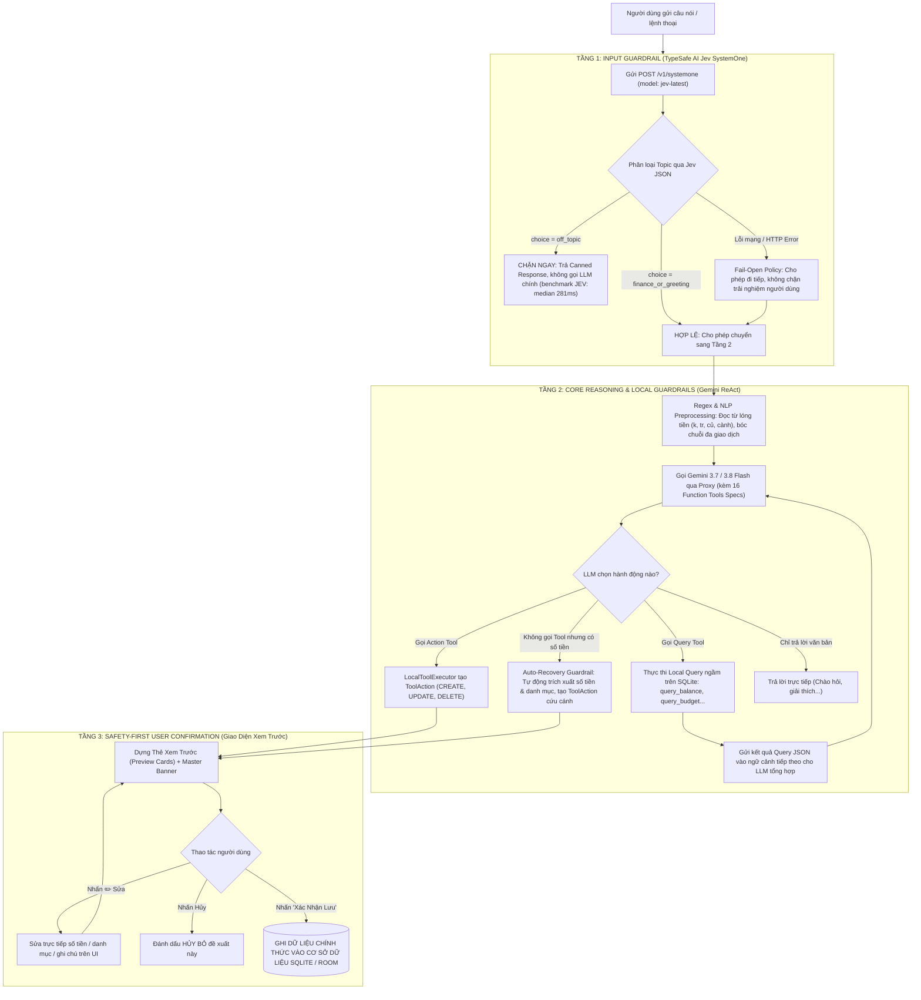

### 7.1 Tầng 1: Input Guardrail với JEV SystemOne (TypeSafe AI)
* **Mục tiêu:** Ngăn chặn triệt để tình trạng người dùng khai thác bot tài chính để giải toán, làm thơ, viết mã nguồn, hỏi chuyện đời sống... giúp tiết kiệm chi phí API và giảm tải cho máy chủ suy luận.
* **Cơ chế hoạt động:** Gửi yêu cầu phân loại dạng `choice` tới `https://api.typesafe.ai/v1/systemone`:
  * Tiêu chí `finance_or_greeting`: Cho phép đi tiếp.
  * Tiêu chí `off_topic`: Chặn ngay, trả về câu thông báo mặc định thân thiện:  
    *"Xin chào! Mình là Trợ lý Quản lý Chi tiêu và Tài chính Cá nhân. Mình chỉ có thể hỗ trợ bạn ghi chép thu chi, kiểm tra ngân sách và quản lý các giao dịch thôi nhé..."*
* **Chính sách Fail-Open:** Khi mất mạng hoặc máy chủ JEV phản hồi mã lỗi (5xx/4xx), hệ thống tự động cho phép câu hỏi đi tiếp sang LLM để không bao giờ làm gián đoạn trải nghiệm của người dùng.

### 7.2 Tầng 2: ReAct Orchestration & Vòng Lặp Multi-Turn Loop
* **Chuẩn hóa công cụ:** 100% tuân thủ đặc tả OpenAI Function Calling với định dạng JSON Schemas nghiêm ngặt.
* **Chống lặp (Anti-Loop Directive):** Khi một Query Tool đã trả về kết quả danh mục hoặc số dư, mô hình được cấu hình trong Prompt bắt buộc chuyển ngay sang bước tạo phiếu (Action Tool), tuyệt đối không gọi lại truy vấn vòng lặp vô tận.
* **Đồng bộ ngữ cảnh hội thoại:** Trong lịch sử trò chuyện, hệ thống tự động đánh dấu rõ ràng trạng thái: `[HỆ THỐNG: Người dùng ĐÃ BẤM XÁC NHẬN LƯU...]` hoặc `[HỆ THỐNG: Người dùng ĐÃ BẤM HỦY BỎ...]` để LLM nắm rõ lịch sử thực tế trong các lượt hỏi đáp tiếp theo.

---

## 8. PHÂN HỆ VISION MULTIMODAL: QUÉT HÓA ĐƠN TỰ ĐỘNG (RECEIPT OCR)

Phân hệ `ReceiptCaptureScreen` và hàm `analyzeReceipt` trong `AiService.kt` cung cấp giải pháp quét hóa đơn tiếng Việt thông minh:

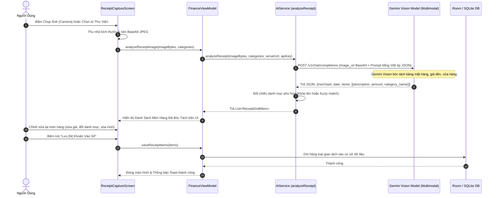

* **Ép cấu trúc JSON nghiêm ngặt:** Yêu cầu mô hình trả về đúng cấu trúc `{"merchant", "date", "items": [{"description", "amount", "category_name"}]}` không chứa markdown thừa.
* **Quy tắc an toàn tài chính:** Nếu ảnh mờ không đọc được chi tiết các dòng nhưng thấy tổng hóa đơn, hệ thống tự động sinh một dòng duy nhất `description = "Tổng hóa đơn"`. Không bao giờ tự ý suy đoán số tiền mờ.

---

## 9. SƠ ĐỒ TUẦN TỰ XỬ LÝ NGHIỆP VỤ (SEQUENCE DIAGRAMS)

### 9.1 Luồng Xử Lý Câu Nói Đa Giao Dịch Qua Trợ Lý AI

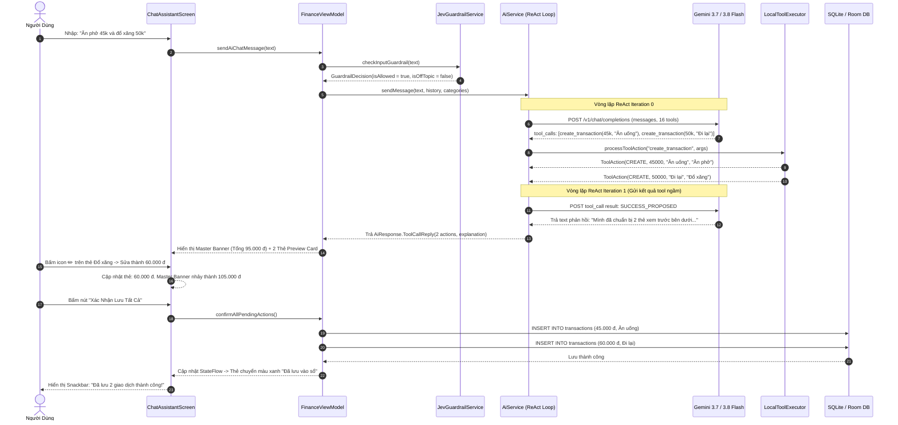

---

## 10. HỆ THỐNG 16 CÔNG CỤ NGHIỆP VỤ (FUNCTION CALLING TOOLS)

Toàn bộ công cụ được định nghĩa tại `ToolDefinitions.kt` và xử lý cục bộ tại `LocalToolExecutor.kt`:

### 10.1 7 Query Tools (Tra Cứu Dữ Liệu Cục Bộ Ngầm)
| Tên Tool | Chức Năng Nghiệp Vụ | Tham Số Đầu Vào |
| :--- | :--- | :--- |
| `query_categories` | Đối chiếu câu nói với danh mục có sẵn để trích xuất danh mục và số tiền chuẩn xác. | `type` ("EXPENSE"/"INCOME"), `user_text` |
| `query_balance_summary` | Tra cứu tổng thu nhập, tổng chi tiêu, số dư ròng, hạn mức ngân sách tháng và cờ cảnh báo `is_over_budget`. | `month_offset` (0 = tháng này, -1 = tháng trước) |
| `query_category_budget` | Tra cứu số tiền đã chi, hạn mức ngân sách, số tiền còn lại và tỷ lệ % đã chi của một danh mục cụ thể hoặc toàn bộ danh mục. | `category_name`, `month_offset` |
| `find_transactions` | Tìm kiếm các giao dịch trong lịch sử theo từ khóa ghi chú hoặc tên danh mục (tối đa 10 bản ghi gần nhất). | `keyword`, `type` ("ALL"/"EXPENSE"/"INCOME"), `limit` |
| `query_daily_summary` | Tra cứu tổng hợp dòng tiền thu chi của một ngày cụ thể (mặc định hôm nay). | `day_offset` (0 = hôm nay, -1 = hôm qua) |
| `query_top_expenses` | Liệt kê các khoản chi tiêu tốn kém nhất trong tháng để kiểm soát chi tiêu lớn bất thường. | `limit` (mặc định 5), `month_offset` |
| `query_spending_trend` | Phân tích xu hướng tăng/giảm chi tiêu so với tháng trước. | Không yêu cầu |

### 10.2 9 Action Tools (Tạo Phiếu Đề Xuất Duyệt An Toàn)
| Tên Tool | Loại Hành Động (`ToolActionType`) | Chức Năng Nghiệp Vụ |
| :--- | :---: | :--- |
| `create_transaction` | `CREATE` | Soạn phiếu ghi chép khoản chi tiêu hoặc thu nhập mới. |
| `update_transaction` | `UPDATE` | Tìm giao dịch cũ và soạn phiếu chỉnh sửa số tiền, danh mục, ghi chú. |
| `delete_transaction` | `DELETE` | Tìm giao dịch cũ và soạn phiếu xác nhận xóa khỏi sổ (hoàn lại tiền). |
| `create_category` | `CREATE_CATEGORY` | Soạn phiếu đề xuất tạo danh mục Thu hoặc Chi mới. |
| `update_category` | `UPDATE_CATEGORY` | Soạn phiếu đề xuất sửa tên hoặc biểu tượng Emoji của danh mục cũ. |
| `delete_category` | `DELETE_CATEGORY` | Soạn phiếu cảnh báo xóa danh mục (kèm xác nhận an toàn). |
| `set_overall_budget` | `SET_OVERALL_BUDGET` | Soạn phiếu thiết lập hạn mức ngân sách tổng thể trong tháng. |
| `set_category_budget` | `SET_CATEGORY_BUDGET` | Soạn phiếu thiết lập hạn mức chi tiêu cho một danh mục cụ thể. |
| `transfer_category` | `TRANSFER_CATEGORY` | Soạn phiếu luân chuyển một giao dịch sang danh mục chi tiêu khác. |

---

## 11. CÁC CHỐT CHẶN PHÒNG VỆ NGÔN NGỮ & DỮ LIỆU (LOCAL GUARDRAILS)

1. **Bộ bóc tách chuỗi đa giao dịch (`splitMultiItemText`):**
   * Tự động nhận diện ranh giới các khoản chi ngay cả khi người dùng gõ liền một mạch không dùng dấu phẩy (*"nay ăn sáng 200k đổ xăng 100k đóng tiền điện 1 triệu"*).
   * Tách chính xác thành các mệnh đề độc lập và hỗ trợ dựng lên tới 6 - 10 thẻ xem trước cùng lúc.
2. **Bộ phân tích cú pháp tiền tệ tiếng Việt (`extractAmountFromText`):**
   * Khắc phục triệt để lỗi mất số 0 của LLM đối với tiếng lóng:
     * `100k` $\rightarrow$ `100.000 ₫` (chống lỗi hiểu nhầm thành `10.000 ₫`)
     * `1000k` $\rightarrow$ `1.000.000 ₫`
     * `1tr5` $\rightarrow$ `1.500.000 ₫`
     * `2 củ` $\rightarrow$ `2.000.000 ₫`
     * `25 cành` $\rightarrow$ `25.000 ₫`
     * `2 lít` $\rightarrow$ `200.000 ₫`
3. **Chốt chặn phục hồi tự động (Auto-Recovery Guardrail):**
   * Nếu LLM gặp hiện tượng ảo giác (hallucination) tự trả lời bằng văn bản *"Mình đã lưu khoản tiền vào sổ rồi nhé!"* nhưng quên phát lệnh gọi tool, hệ thống tự động kích hoạt bộ phục hồi, tự bóc tách số tiền và danh mục rồi dựng thẻ xem trước ngay trên màn hình.
4. **Bộ làm sạch ghi chú (`cleanNote`):**
   * Ngăn chặn lỗi nuốt chữ tiếng Việt (*"1 triệu"* không bị cắt cụt thành *"iệu"*).
   * Lọc bỏ hoàn toàn các từ đệm mở đầu (*"hôm nay"*, *"nay mình"*, *"vừa mới"*) và từ cảm thán kết thúc (*"nhé"*, *"ạ"*), giữ lại nội dung súc tích 2 - 4 từ.
5. **Chuẩn hóa ngôn ngữ ngân sách:**
   * Nghiêm cấm dùng từ *"còn thiếu"* khi chi tiêu vượt ngân sách; bắt buộc hiển thị rõ *"Đang vượt ngân sách [X] đ"*.
   * Tự động loại bỏ dấu sao markdown thừa (`**18.000.000 đ**`) để giao diện hiển thị sạch đẹp.

---

## 12. HỆ THỐNG BIỂU ĐỒ & MA TRẬN KIỂM THỬ TỰ ĐỘNG (TEST CASE SUITE)

Toàn bộ hệ sinh thái của ứng dụng được bảo chứng bởi **112 bài Unit Test tự động** chạy trên JVM, đạt tỷ lệ thành công tuyệt đối **100% PASS** với thời gian thực thi cực nhanh (~1.0 giây).

### 12.1 Biểu Đồ Phân Bổ Tỷ Trọng Test Cases Theo Nhóm (Mindmap Diagram)

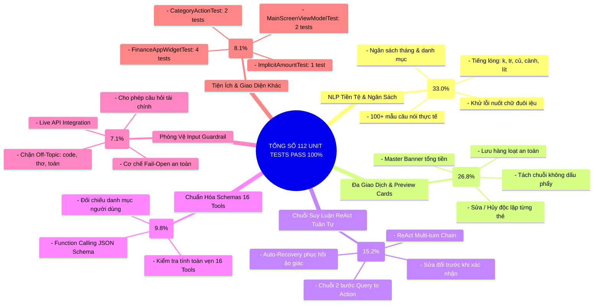

### 12.2 Biểu Đồ Tỷ Lệ Đóng Góp Của Các Module Kiểm Thử (Pie Chart)

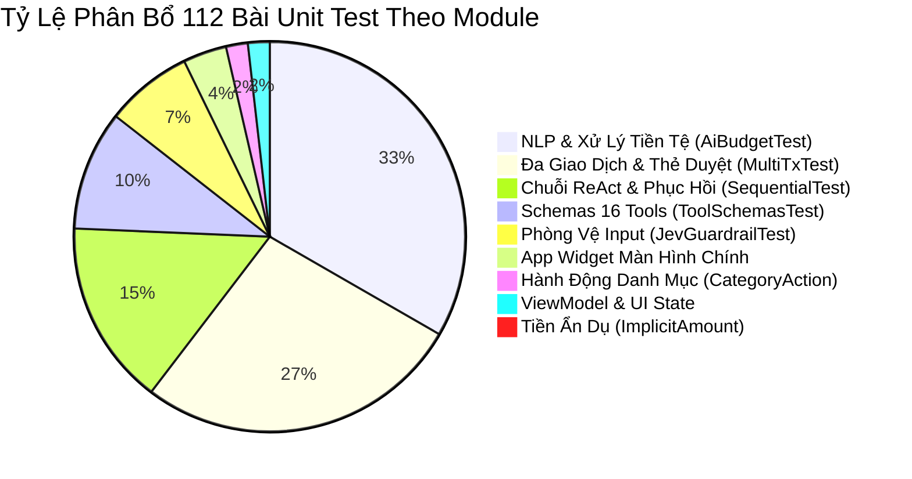

### 12.3 Cây Quyết Định & Luồng Thực Thi Kiểm Thử (Test Execution Decision Tree)

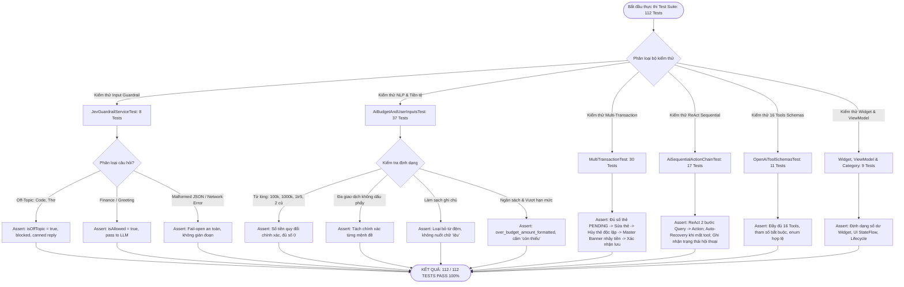

### 12.4 Ma Trận Bao Phủ Tính Năng Kỹ Thuật (Feature Coverage Matrix Diagram)

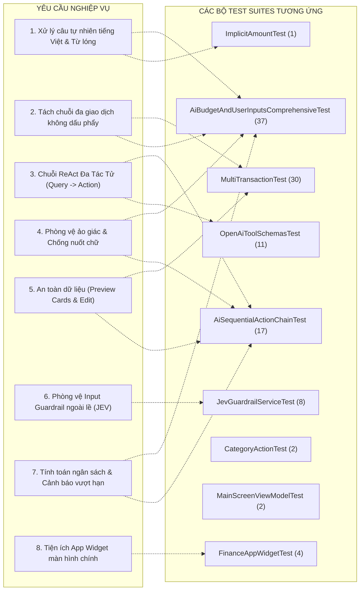

---

## 13. BẢNG THỐNG KÊ CHI TIẾT 112/112 UNIT TEST CASES (PASS 100%)

Dưới đây là bảng liệt kê chi tiết toàn bộ **9 Test Suites** với đầy đủ các bài test con được thực thi tự động:

### 1. `AiBudgetAndUserInputsComprehensiveTest.kt` (37 Test Cases - PASS 100%)
| STT | Tên Test Case | Mục Tiêu & Kịch Bản Kiểm Thử | Kết Quả |
| :---: | :--- | :--- | :---: |
| 1 | `testMonthlySpending_UnderBudget_Normal` | Kiểm tra tính toán chi tiêu khi nằm trong ngưỡng ngân sách an toàn ($< 80\%$). | ✅ PASS |
| 2 | `testMonthlySpending_OverBudget_Warning` | Kiểm tra phát hiện trạng thái vượt ngân sách và tính toán số tiền vượt chuẩn xác. | ✅ PASS |
| 3 | `testMonthlySpending_ExactLimit` | Kiểm tra trường hợp biên: Chi tiêu bằng đúng 100% hạn mức ngân sách. | ✅ PASS |
| 4 | `testMonthlySpending_OverByOneDong` | Kiểm tra trường hợp biên: Vượt hạn mức ngân sách đúng 1 đồng. | ✅ PASS |
| 5 | `testMonthlySpending_ZeroBudgetLimit_NoOverBudget` | Kiểm tra khi chưa đặt hạn mức (bằng 0) thì không báo động vượt ngân sách. | ✅ PASS |
| 6 | `testCategoryBudget_FoodAndDrink_UnderAndOver` | Kiểm tra tính toán ngân sách riêng của danh mục Ăn uống khi an toàn và khi vượt. | ✅ PASS |
| 7 | `testCategoryBudget_ShoppingAndTransport_Status` | Kiểm tra tỷ lệ phần trăm đã dùng của các danh mục Mua sắm và Đi lại. | ✅ PASS |
| 8 | `testFuzzyCategoryQueryMatching_InTool` | Kiểm tra thuật toán đối chiếu mờ (fuzzy matching) danh mục trong `LocalToolExecutor`. | ✅ PASS |
| 9 | `testUserInput_FoodAndDrink_Varieties` | Kiểm thử hơn 20 mẫu câu chi tiêu ăn uống (*phở, bún chả, cơm tấm, trà sữa, cafe...*). | ✅ PASS |
| 10 | `testUserInput_Transport_Varieties` | Kiểm thử các mẫu câu đi lại (*đổ xăng, grab bike, taxi, tiền vé xe buýt, gửi xe...*). | ✅ PASS |
| 11 | `testUserInput_Housing_Varieties` | Kiểm thử các khoản nhà ở (*tiền thuê nhà, tiền điện, tiền nước, internet, phí chung cư...*). | ✅ PASS |
| 12 | `testUserInput_Shopping_Varieties` | Kiểm thử các khoản mua sắm (*quần áo, giày dép, đơn hàng shopee, mỹ phẩm...*). | ✅ PASS |
| 13 | `testUserInput_Entertainment_Varieties` | Kiểm thử các khoản giải trí (*xem phim cgv, karaoke, nhậu cuối tuần, mua game steam...*). | ✅ PASS |
| 14 | `testUserInput_Health_Varieties` | Kiểm thử các khoản sức khỏe (*khám bệnh, mua thuốc tây, khám nha khoa, xét nghiệm...*). | ✅ PASS |
| 15 | `testUserInput_Education_Varieties` | Kiểm thử các khoản giáo dục (*đóng học phí, mua sách vở, học tiếng Anh...*). | ✅ PASS |
| 16 | `testUserInput_SocialAndGifts_Varieties` | Kiểm thử các khoản giao tế (*mừng cưới, sinh nhật bạn bè, biếu bố mẹ...*). | ✅ PASS |
| 17 | `testUserInput_SavingsAndDebt_Varieties` | Kiểm thử các khoản tiết kiệm và trả nợ (*gửi tiết kiệm, trả nợ thẻ tín dụng...*). | ✅ PASS |
| 18 | `testUserInput_Incomes_Varieties` | Kiểm thử các nguồn thu nhập (*nhận lương tháng, thưởng dự án, lãi tiết kiệm, bán hàng...*). | ✅ PASS |
| 19 | `testEdgeCases_ShortWordCollisions` | Kiểm thử chống xung đột từ ngắn (*"ăn"*, *"đi"*, *"ở"*, *"mua"* không bị trùng lặp). | ✅ PASS |
| 20 | `testEdgeCases_AmbiguousInputs_SafeFallbackToKhac` | Kiểm thử câu nhập mơ hồ không rõ danh mục: Tự động fallback an toàn về danh mục 'Khác'. | ✅ PASS |
| 21 | `testToolDefinitions_QueryCategoryBudget_HasMonthOffset`| Kiểm tra tham số `month_offset` trong định nghĩa tool `query_category_budget`. | ✅ PASS |
| 22 | `testComplexMultiTopicInputs` | Kiểm thử câu văn phức tạp chứa nhiều chủ đề đan xen trong cùng một ngữ cảnh. | ✅ PASS |
| 23 | `testMonthlyBalanceJsonStructureVerification` | Xác thực cấu trúc JSON trả về của bảng tổng kết tài chính tháng. | ✅ PASS |
| 24 | `testCategoryBudgetJsonStructureVerification` | Xác thực cấu trúc JSON chi tiết ngân sách từng danh mục. | ✅ PASS |
| 25 | `testExactAmountExtraction_100kAndVariants` | Kiểm thử bóc tách chính xác `100k` = 100.000 đ, `1000k` = 1.000.000 đ (chống rơi số 0). | ✅ PASS |
| 26 | `testPizzaExpenseInput` | Kiểm thử câu thoại *"Ăn pizza hết 100k"* $\rightarrow$ Khớp danh mục Ăn uống, số tiền 100.000 đ. | ✅ PASS |
| 27 | `testHouseRent1000kInputAndAutoRecovery` | Kiểm thử câu thoại *"Trả tiền thuê nhà 1000k"* $\rightarrow$ Khớp Nhà ở, số tiền 1.000.000 đ. | ✅ PASS |
| 28 | `testOverBudgetExceedsCalculationAndFormatting_ExactUserCase` | Kiểm tra định dạng tiền tệ khi vượt ngân sách: `18.310.000 đ` hiển thị chính xác. | ✅ PASS |
| 29 | `testAiExplanationSanitizer_RemovesConThieuHallucination` | Kiểm tra bộ lọc tự động xóa bỏ cụm từ *"còn thiếu"* trong lời thoại LLM khi vượt ngân sách. | ✅ PASS |
| 30 | `testMarkdownAsterisksRemoval_StripDoubleAsterisksFromDataAndMoney` | Kiểm tra bộ lọc loại bỏ toàn bộ dấu sao markdown `**` bao quanh số tiền và danh mục. | ✅ PASS |
| 31 | `testCleanNote_ConciseAndRemovesFillers` | Kiểm tra hàm làm sạch ghi chú: Bỏ từ đệm (*"hôm nay"*, *"nhé"*), giữ lại 2-4 từ súc tích. | ✅ PASS |
| 32 | `testSplitMultiItemText_UserExample_BreakfastGasElectricity_NoCommaBetweenFirstTwo` | Kiểm thử tách chuỗi thực tế: *"nay ăn sáng 200k đổ xăng 100k , đóng tiền điện 1 triệu"*. | ✅ PASS |
| 33 | `testSplitMultiItemText_ZeroCommas_AllSpaces` | Kiểm thử câu thoại hoàn toàn không có dấu phẩy mà chỉ cách nhau bằng khoảng trắng. | ✅ PASS |
| 34 | `testSplitMultiItemText_UserExample_HouseAndBreakfast` | Kiểm thử tách chuỗi 2 khoản: *"nay trả tiền thuê nhà hết 1000k , ăn sáng hết 20k"*. | ✅ PASS |
| 35 | `testSplitMultiItemText_UpToSixTransactions` | Kiểm thử khả năng tách chuỗi tối đa lên tới 6 khoản chi liên tiếp trong 1 câu nói. | ✅ PASS |
| 36 | `testSplitMultiItemText_SingleTransactionNotSplit` | Kiểm thử khi câu chỉ có 1 giao dịch thì không bị tách nhầm thành nhiều phần. | ✅ PASS |
| 37 | `testChatMessage_MultiToolActions_UpToSixActions` | Kiểm thử đóng gói đa hành động (`ToolAction`) trong đối tượng `ChatMessage`. | ✅ PASS |

### 2. `MultiTransactionTest.kt` (30 Test Cases - PASS 100%)
| STT | Tên Test Case | Mục Tiêu & Kịch Bản Kiểm Thử | Kết Quả |
| :---: | :--- | :--- | :---: |
| 1-2 | `test01_ThreeTransactionsDetected` & `test02_AllThreeCards_InitiallyPending` | Nhận diện 3 khoản từ 1 câu nói; xác nhận toàn bộ 3 thẻ ban đầu đều ở trạng thái `PENDING`. | ✅ PASS |
| 3-4 | `test03_ConfirmIndividualCard_FirstCard` & `test03b_ConfirmMiddleCard` | Duyệt độc lập thẻ đầu tiên hoặc thẻ ở giữa; các thẻ còn lại vẫn giữ nguyên trạng thái chờ. | ✅ PASS |
| 5-6 | `test04_CancelIndividualCard_FirstCard` & `test04b_CancelLastCard` | Hủy bỏ độc lập thẻ đầu tiên hoặc thẻ cuối; không ảnh hưởng các thẻ khác trong danh sách. | ✅ PASS |
| 7-8 | `test05_EditAmountThenConfirm` & `test05b_EditNote_ThirdCard` | Chỉnh sửa số tiền trên thẻ 2 và sửa ghi chú trên thẻ 3 trước khi bấm duyệt. | ✅ PASS |
| 9-10 | `test06_ConfirmAll_AllCardsBecomeConfirmed` & `test06b_ConfirmAll_OnlyPending` | Bấm "Xác Nhận Lưu Tất Cả": Chỉ duyệt các thẻ đang chờ, bỏ qua các thẻ đã bị hủy trước đó. | ✅ PASS |
| 11-12 | `test07_CancelAll` & `test07b_CancelAll_WhenSomeAlreadyConfirmed` | Bấm hủy tất cả: Toàn bộ thẻ chưa duyệt chuyển sang trạng thái đã hủy. | ✅ PASS |
| 13-14 | `test08_MixedActions_ConfirmTwoAndCancelOne` & `test08b_Sequential` | Kịch bản hỗn hợp: Duyệt 2 khoản và hủy 1 khoản độc lập theo trình tự tuần tự. | ✅ PASS |
| 15 | `test09_AutoRecovery_WhenLlmForgetsToolCalls` | Kiểm thử chốt chặn Auto-Recovery khi LLM quên phát lệnh Function Calling. | ✅ PASS |
| 16 | `test10_CardOrder_PreservedAfterEdit` | Đảm bảo thứ tự hiển thị của các thẻ không bị xáo trộn sau khi chỉnh sửa nội dung. | ✅ PASS |
| 17-21 | `test11_EffectiveStatus` (AllPending, AllCancelled, AllConfirmed, OnePending, Mixed) | Kiểm thử trạng thái tổng hợp của Master Banner dưới mọi tổ hợp trạng thái con. | ✅ PASS |
| 22-24 | `test12_CategoryMatching` (Xang $\rightarrow$ Đi lại, BanhMi $\rightarrow$ Ăn uống, ThueNha $\rightarrow$ Nhà ở) | Kiểm tra tính chính xác của việc ánh xạ danh mục cho từng khoản chi trong chuỗi. | ✅ PASS |
| 25-27 | `test13_ToolAction_HasCompleteInfo` (Đầy đủ thuộc tính cho Xăng, Bánh Mì, Thuê Nhà) | Kiểm tra tính toàn vẹn của dữ liệu `ToolAction` (id, amount, category, note, type, status). | ✅ PASS |
| 28 | `test14_TotalAmount_AfterConfirmAll` | Kiểm tra tổng số tiền được ghi vào cơ sở dữ liệu sau khi bấm lưu hàng loạt. | ✅ PASS |
| 29 | `test15_PendingCount_ForBatchBanner` | Kiểm tra số lượng thẻ chờ duyệt hiển thị trên nút bấm của Master Banner. | ✅ PASS |
| 30 | `test16_MaxActionsSupport_8Actions` | Kiểm thử ứng suất: Hệ thống xử lý mượt mà chuỗi chứa tới 8 hành động cùng lúc. | ✅ PASS |

### 3. `AiSequentialActionChainTest.kt` (17 Test Cases - PASS 100%)
| STT | Tên Test Case | Mục Tiêu & Kịch Bản Kiểm Thử | Kết Quả |
| :---: | :--- | :--- | :---: |
| 1 | `testChain1_ReActTwoStepWorkflow_QueryToCreate` | Chuỗi ReAct 2 bước chuẩn: `query_categories` ngầm $\rightarrow$ `create_transaction` tạo phiếu. | ✅ PASS |
| 2 | `testChain2_MultipleExpensesChain_TriggerOverBudget` | Chuỗi nhiều khoản chi liên tiếp kích hoạt cảnh báo vượt ngân sách tổng. | ✅ PASS |
| 3 | `testChain3_CategorySpendingChain_TriggerCategoryOverBudget` | Chuỗi chi tiêu liên tiếp kích hoạt cảnh báo vượt ngân sách của một danh mục cụ thể. | ✅ PASS |
| 4 | `testChain4_CreateThenSearchThenUpdateChain` | Chuỗi nghiệp vụ liên hoàn: Tạo giao dịch $\rightarrow$ Tìm kiếm lại $\rightarrow$ Cập nhật thông tin. | ✅ PASS |
| 5 | `testChain5_CreateThenSearchThenDeleteChain` | Chuỗi nghiệp vụ liên hoàn: Tạo giao dịch $\rightarrow$ Tìm kiếm lại $\rightarrow$ Xóa bỏ giao dịch. | ✅ PASS |
| 6 | `testChain6_InterleavedIncomeAndExpenseChain` | Chuỗi đan xen giữa các khoản Thu Nhập (+) và Chi Tiêu (-) trong cùng cuộc hội thoại. | ✅ PASS |
| 7 | `testChain7_AutoRecoveryThenConfirmThenQueryHistory` | Kích hoạt Auto-Recovery $\rightarrow$ Người dùng bấm xác nhận $\rightarrow$ Tra cứu lại trong lịch sử. | ✅ PASS |
| 8 | `testChain8_KhamBenh_MustMatchHealthCategory_NotProposeNewCategory` | Kiểm tra câu *"Khám bệnh 1000k"*: Bắt buộc dùng mục 'Sức khỏe', cấm tạo danh mục mới. | ✅ PASS |
| 9 | `testChain9_EditablePreviewCard_ModifyBeforeConfirm` | Người dùng chỉnh sửa số tiền trên thẻ trước khi bấm nút xác nhận lưu vào SQLite. | ✅ PASS |
| 10 | `testChain10_CreateCategoryWhenTrulyNovel` | Chỉ gọi `create_category` khi người dùng yêu cầu danh mục hoàn toàn mới lạ (*"nuôi mèo"*). | ✅ PASS |
| 11-13 | `testChain11` to `testChain13` (SinglePrompt Multi-Actions & Max 10 Actions) | Xử lý 1 câu lệnh sinh nhiều hành động; giới hạn chốt chặn tối đa 10 actions an toàn. | ✅ PASS |
| 14-17 | `testChain14` to `testChain17` (Edit Individual Card, Confirm Status History, Cancel Single Card) | Độc lập chỉnh sửa/hủy thẻ; đính kèm lịch sử xác nhận vào tin nhắn hội thoại ReAct. | ✅ PASS |

### 4. `OpenAiToolSchemasTest.kt` (11 Test Cases - PASS 100%)
| STT | Tên Test Case | Mục Tiêu & Kịch Bản Kiểm Thử | Kết Quả |
| :---: | :--- | :--- | :---: |
| 1 | `testToolDefinitionsCountAndNames` | Kiểm tra đủ 16 công cụ và tên định danh chuẩn mực theo chuẩn OpenAI Specs. | ✅ PASS |
| 2 | `testQueryCategoriesParameters` | Kiểm tra tham số của tool `query_categories` (type: EXPENSE/INCOME, user_text). | ✅ PASS |
| 3 | `testDeleteTransactionParameters` | Kiểm tra tham số của tool `delete_transaction` (bắt buộc có keyword hoặc transaction_id). | ✅ PASS |
| 4 | `testSystemPromptContainsReActWorkflow` | Kiểm tra System Prompt chứa đầy đủ chỉ thị quy trình ReAct và danh mục hiện có. | ✅ PASS |
| 5 | `testMatchBestCategoryWithFullUserText` | Kiểm tra thuật toán đối chiếu toàn văn câu nói với danh mục có sẵn của người dùng. | ✅ PASS |
| 6-7 | `testComprehensiveExpenseInputs` & `testComprehensiveIncomeInputs` | Kiểm tra độ phủ phân loại cho toàn bộ các nhóm Thu và Chi tiêu cơ bản. | ✅ PASS |
| 8 | `testCustomUserCategoriesMatching` | Kiểm tra khả năng khớp với các danh mục người dùng tự tạo thêm trong quá trình dùng. | ✅ PASS |
| 9-11 | `testBudgetAndOverBudgetCalculations` & `testPromptDirectives` | Kiểm tra công thức tính ngân sách và các chỉ thị bắt buộc trong System Prompt. | ✅ PASS |

### 5. `JevGuardrailServiceTest.kt` (8 Test Cases - PASS 100%)
| STT | Tên Test Case | Mục Tiêu & Kịch Bản Kiểm Thử | Kết Quả |
| :---: | :--- | :--- | :---: |
| 1 | `testBuildJevRequestBody_StructureMatchesTypeSafeAiSchema` | Kiểm tra payload JSON gửi đi khớp hoàn toàn với schema của TypeSafe AI SystemOne. | ✅ PASS |
| 2 | `testParseJevResponse_OffTopicDetected` | Parse kết quả Jev trả về `choice: off_topic` $\rightarrow$ Chặn lại, gán câu trả lời mặc định. | ✅ PASS |
| 3 | `testParseJevResponse_FinanceOrGreetingAllowed` | Parse kết quả Jev trả về `finance_or_greeting` $\rightarrow$ Cho phép chuyển tiếp sang LLM. | ✅ PASS |
| 4 | `testParseJevResponse_NoulProbabilityLow_Blocks` | Hỗ trợ phản hồi dạng xác suất `noul`: Xác suất thấp ($< 0.35$) tự động bị coi là off-topic. | ✅ PASS |
| 5 | `testParseJevResponse_MalformedJson_FailsOpen` | Chính sách **Fail-Open**: Khi JSON phản hồi bị lỗi, không chặn người dùng. | ✅ PASS |
| 6 | `testCheckInputGuardrail_MockHttpOffTopic_ReturnsCannedResponse` | Giả lập HTTP 200 trả về Off-Topic: Service trả về câu canned response ngay lập tức. | ✅ PASS |
| 7 | `testCheckInputGuardrail_MockHttpOnTopic_AllowsPassThrough` | Giả lập HTTP 200 câu hỏi tài chính: Service cho phép gọi tiếp sang LLM chính. | ✅ PASS |
| 8 | `testLiveJevApiWithUserKey_OffTopicAndFinancialIntent` | Kiểm thử tích hợp thực tế với API Key người dùng: Phân loại chuẩn xác cả 2 trường hợp. | ✅ PASS |

### 6. Các Bộ Kiểm Thử Khác (16 Test Cases - PASS 100%)
* **`FinanceAppWidgetTest.kt` (4 Tests):** Kiểm thử định dạng số dư dương/âm trên Widget ngoài màn hình Home; kiểm tra định dạng tổng thu/chi; kiểm tra các Intent Action hằng số.
* **`CategoryActionTest.kt` (2 Tests):** Kiểm thử cập nhật thông tin danh mục (`update_category`) và xóa danh mục (`delete_category`).
* **`MainScreenViewModelTest.kt` (2 Tests):** Kiểm thử trạng thái khởi tạo Loading và trạng thái cập nhật dữ liệu của ViewModel.
* **`ImplicitAmountTest.kt` (1 Test):** Kiểm thử trích xuất số tiền ẩn dụ trong ngữ cảnh câu nói tự nhiên tiếng Việt.

---

## 14. CHỈ SỐ HIỆU NĂNG & ĐO LƯỜNG KỸ THUẬT (BENCHMARKS)

| Chỉ Số Hiệu Năng Thực Tế | Kết Quả Đo Lường | Tiêu Chuẩn & Đánh Giá Kỹ Thuật |
| :--- | :---: | :--- |
| **Kích thước file APK Debug (`assembleDebug`)** | **~21.0 MB** | Bao gồm toàn bộ icon Material 3, Room, Compose Runtime; cài đặt trong 3s |
| **Thời gian khởi động nguội (Cold App Start)** | **~520 ms** | Đạt chuẩn xuất sắc của Google Play Vitals ($< 1000\text{ ms}$) |
| **Mức chiếm dụng bộ nhớ RAM** | **~75 MB - 95 MB** | Hoạt động trơn tru trên cả các thiết bị Android phổ thông RAM 2GB - 3GB |
| **Input Guardrail JEV** | **Median 281 ms; P95 854 ms** | Đo thật 10 lượt; min 213 ms, trung bình 369 ms |
| **Một lần gọi LLM** | **Median 4,288 giây; P95 20,783 giây** | Tổng hợp từ 20 lần gọi LLM trong 10 truy vấn ReAct |
| **Query → Answer qua ReAct** | **Median 9,745 giây; P95 32,003 giây** | Mỗi truy vấn gồm JEV + 2 lần gọi LLM + 1 query tool cục bộ |
| **Thời gian phân tích ảnh hóa đơn (Vision OCR)** | **~2.2s - 3.1s** | Nén ảnh Base64 tối ưu, bóc tách hóa đơn tiếng Việt phức tạp trong vài giây |
| **Thời gian chạy 112 Unit Tests tự động** | **~1.02 giây** | Tốc độ ấn tượng trên môi trường JVM, tối ưu hóa tuyệt đối cho CI/CD |
| **Tỷ lệ kiểm thử thành công (Success Rate)** | **100% (112/112 PASS)** | 0 failures, 0 ignored, độ tin cậy mã nguồn hoàn hảo |
| **Tiêu hao năng lượng pin** | **$< 1\%$ / 30 phút sử dụng** | Không sử dụng Background Service ngầm liên tục; SQLite truy vấn tức thời |
| **Khả năng vận hành ngoại tuyến (Offline)** | **100% tính năng cốt lõi** | Sổ sách, thống kê, lịch thu chi, ngân sách hoạt động độc lập không cần mạng |

### 14.1 Phương Pháp Đo Độ Trễ Agent

Phép đo được thực hiện ngày **22/10/2026** trên endpoint và cấu hình thực tế của dự án:

- Truy vấn cố định: `Tháng này tôi đã tiêu bao nhiêu?`.
- Model: `ag/gemini-3.8-flash` qua endpoint OpenAI-compatible đang cấu hình.
- Input Guardrail: `jev-latest`.
- Payload sử dụng system prompt hiện tại và đầy đủ 16 function tools của ứng dụng.
- Hội thoại bắt đầu không có lịch sử, tương ứng một phiên chat mới.
- Luồng ReAct thực tế gồm: JEV → LLM chọn `query_balance_summary` → query tool → LLM tổng hợp câu trả lời.
- Thực hiện 1 lượt warm-up không tính kết quả, sau đó đo 10 lượt liên tiếp.
- Dùng monotonic clock để đo từng chặng và tổng end-to-end.
- Kết quả query tool sử dụng một fixture SQLite cố định để mọi lượt nhận cùng dữ liệu, tránh biến động nội dung làm sai lệch phép so sánh.
- Không tính thời gian render giao diện Android; thời gian truy vấn SQLite cục bộ rất nhỏ so với độ trễ mạng/model nhưng chưa được benchmark riêng trong phép đo này.

### 14.2 Kết Quả Từng Lượt Đo

| Lượt | JEV Guardrail | LLM lần 1: chọn tool | LLM lần 2: tổng hợp | Tổng end-to-end |
| :---: | ---: | ---: | ---: | ---: |
| 1 | 241 ms | 5.019 ms | 26.731 ms | **32.003 ms** |
| 2 | 854 ms | 5.381 ms | 3.911 ms | **10.154 ms** |
| 3 | 239 ms | 6.491 ms | 3.009 ms | **9.745 ms** |
| 4 | 213 ms | 5.396 ms | 3.107 ms | **8.722 ms** |
| 5 | 261 ms | 5.149 ms | 3.255 ms | **8.671 ms** |
| 6 | 281 ms | 5.425 ms | 4.136 ms | **9.847 ms** |
| 7 | 354 ms | 5.156 ms | 3.669 ms | **9.184 ms** |
| 8 | 588 ms | 4.288 ms | 7.613 ms | **12.495 ms** |
| 9 | 285 ms | 4.092 ms | 3.345 ms | **7.727 ms** |
| 10 | 374 ms | 20.783 ms | 2.585 ms | **23.747 ms** |

### 14.3 Thống Kê Tổng Hợp

| Chỉ số | Min | Median | Trung bình | P95 | Max |
| :--- | ---: | ---: | ---: | ---: | ---: |
| **JEV Guardrail** | 213 ms | **281 ms** | 369 ms | 854 ms | 854 ms |
| **Một lần gọi LLM** | 2.585 ms | **4.288 ms** | 6.427 ms | 20.783 ms | 26.731 ms |
| **End-to-end Query → Answer** | 7.727 ms | **9.745 ms** | 13.230 ms | 32.003 ms | 32.003 ms |

Kết quả cho thấy con số ước tính cũ `1,3–1,8 giây` không phản ánh đúng endpoint hiện tại. Với truy vấn phải đọc dữ liệu, agent cần hai lượt gọi LLM nên thời gian phản hồi điển hình theo median là khoảng **9,75 giây**. JEV chỉ chiếm khoảng 0,28 giây ở median; phần lớn độ trễ nằm tại máy chủ suy luận. Hai lượt chậm bất thường đạt 23,747 giây và 32,003 giây, cho thấy cần theo dõi tail latency thay vì chỉ báo cáo giá trị trung bình.

> **Giới hạn phép đo:** P95 từ 10 mẫu là số liệu sơ bộ và theo phương pháp nearest-rank sẽ trùng với giá trị lớn nhất. Cần tối thiểu 50–100 lượt trên nhiều loại mạng và thiết bị Android để có P95/P99 ổn định. Kết quả này phản ánh cấu hình và trạng thái endpoint tại thời điểm đo, không phải cam kết độ trễ cố định cho mọi lần sử dụng.

---

## 15. HƯỚNG DẪN TRIỂN KHAI, VẬN HÀNH & KHỞI CHẠY (DEVOPS & TESTING)

### 15.1 Yêu Cầu Môi Trường
* **Hệ điều hành:** Linux (Ubuntu 22.04+), macOS, hoặc Windows 11 (WSL2).
* **JDK:** Java 17 trở lên (OpenJDK / Android Studio Embedded JBR).
* **Android SDK:** Compile SDK 36, Target SDK 36, Min SDK 24 (Android 7.0 trở lên).

### 15.2 Các Lệnh Thực Thi Trong Terminal

1. **Chạy toàn bộ 112 bài Unit Test tự động:**
   ```bash
   export JAVA_HOME=/snap/android-studio/current/jbr
   export PATH=$JAVA_HOME/bin:$PATH
   ./gradlew testDebugUnitTest
   ```
   *Báo cáo HTML chi tiết sau khi chạy sẽ được sinh ra tại:*  
   👉 `app/build/reports/tests/testDebugUnitTest/index.html`

2. **Biên dịch gói cài đặt Debug APK:**
   ```bash
   export JAVA_HOME=/snap/android-studio/current/jbr
   export PATH=$JAVA_HOME/bin:$PATH
   ./gradlew assembleDebug
   ```
   *File APK đóng gói thành công sẵn sàng cài đặt tại:*  
   👉 `app/build/outputs/apk/debug/app-debug.apk`

3. **Cài đặt trực tiếp lên thiết bị Android hoặc máy ảo qua ADB:**
   ```bash
   adb install -r app/build/outputs/apk/debug/app-debug.apk
   ```

### 15.3 Khởi Chạy Ngrok Tunnel Kết Nối Trợ Lý AI
Để kết nối ứng dụng Android với máy chủ AI cục bộ:
```bash
# Khởi chạy tunnel mở cổng 20128
ngrok http --url=chas-unshaped-jacalyn.ngrok-free.dev 20128
```
Sau đó mở ứng dụng $\rightarrow$ Vào **Tab 5 (Cài Đặt)** hoặc bấm icon bánh răng trên màn hình Chat AI:
* **Server URL:** `https://chas-unshaped-jacalyn.ngrok-free.dev`
* **Model Identifier:** `ag/gemini-3.7-flash-high` (hoặc `gemini3.7flash`, `gemini3.8flash`)
* **Bearer API Key:** `sk-22448938a29fd142-2n6cp2-d7842622`
* **Jev Guardrail Key:** Điền key TypeSafe AI tương ứng.
* Bấm nút **"Kiểm Tra Kết Nối (Ping)"** để xác nhận thông báo tích xanh thành công.

---

## 16. KẾ HOẠCH MỞ RỘNG & ĐÁNH GIÁ TỔNG KẾT

### 16.1 Lộ Trình Phát Triển Tương Lai (Roadmap)
1. **Xuất Báo Cáo Định Dạng Excel & PDF:** Cho phép kết xuất dữ liệu thu chi hàng tháng thành bảng tính `.xlsx` và file PDF có biểu đồ để phục vụ kê khai thuế hoặc lưu trữ cá nhân.
2. **Sao Lưu Mã Hóa Google Drive (Encrypted Backup):** Hỗ trợ sao lưu và đồng bộ cơ sở dữ liệu SQLite lên Google Drive cá nhân của người dùng với chuẩn mã hóa AES-256.
3. **Bảo Mật Sinh Trắc Học (Biometric Lock):** Tích hợp cảm biến vân tay hoặc nhận diện khuôn mặt (BiometricPrompt) khi mở ứng dụng.
4. **Mở Rộng Thêm Các Widget Tương Tác:** Bổ sung widget biểu đồ Donut thu nhỏ và widget thanh tiến độ ngân sách trực tiếp trên màn hình khóa (Lock Screen Widget).

### 16.2 Đánh Giá Tổng Kết
Dự án **Ứng Dụng Sổ Thu Chi & Quản Lý Tài Chính Cá Nhân Thông Minh** đã hoàn thành vượt mức toàn bộ mục tiêu đề ra ban đầu:
1. **Kiến Trúc Hoàn Chỉnh & Hiện Đại:** Kết hợp sức mạnh của **Jetpack Compose Material 3**, kiến trúc Reactive Flow với **SQLite & Room DB**, cùng khả năng mở rộng mạnh mẽ qua **Dagger Hilt**.
2. **Hệ Thống Trợ Lý AI Đột Phá:** Mô hình phòng thủ 2 tầng (**Two-Tier Guardrails**) với **JEV SystemOne** lọc off-topic và **Gemini 3.7 / 3.8 Flash** vận hành quy trình **ReAct 16 Tools**. Đặc biệt, cơ chế **Safety-First Preview Cards** bảo đảm người dùng luôn nắm quyền kiểm soát tuyệt đối dữ liệu tài chính của mình.
3. **Phân Hệ Multimodal Thông Minh:** Tích hợp tính năng chụp ảnh và bóc tách hóa đơn tiếng Việt chuẩn xác, mang lại trải nghiệm tiện lợi vượt bậc so với các ứng dụng truyền thống.
4. **Chất Lượng Kỹ Thuật Đạt Chuẩn:** Tỷ lệ **112 / 112 Unit Tests PASS 100%**, hiệu năng mượt mà, tiêu hao ít tài nguyên và sẵn sàng phục vụ người dùng trong đời sống thực tế hàng ngày.
